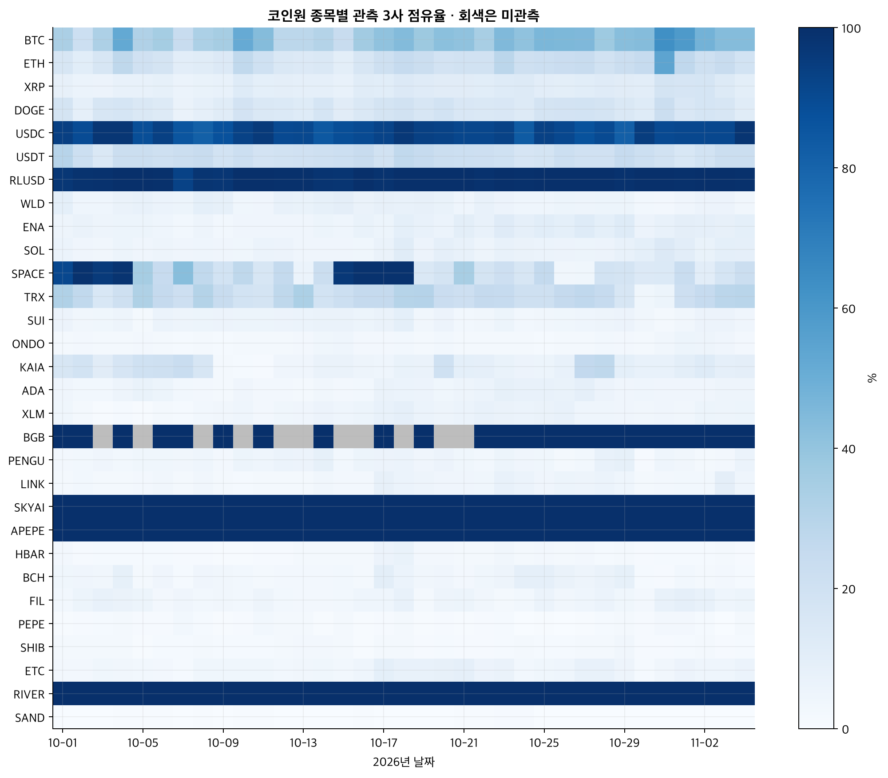

# 코인원 분석 방법·일별·강건성 부록 (2026-11-06)

## 읽는 순서와 관측 계약

본문의 수치는 관측된 거래대금에 대한 기술 통계와 제한적인 연관성 추정으로 나뉘며, 인과 기여율을 보고하지 않는다.

[종합 보고서](coinone-volume-analysis-20261104.md)의 결론·정정표가 기존 문서의 표현보다 우선한다. 여기서는 일별 합계·표본·산식·결측 처리·대안 정의를 공개한다. 코드와 원시 호가·체결·프로필·주소는 포함하지 않는다.

| 9/1–11/4 현재 KRW 목록 | 시장 수 | 완료 일봉 관측 수 | 수집 오류 수 |
| --- | --- | --- | --- |
| 코인원 | 357 | 23,205 | 0 |
| 업비트 | 300 | 18,837 | 0 |
| 빗썸 | 488 | 30,726 | 0 |

코인원·업비트는 UTC 일봉, 빗썸은 KST 일봉이다. 시간봉은 거래대금이 제공되는 공식 필드로 합산했다. 거래 없는 시간봉을 생략하는 API와 수집 누락을 완전히 구분할 수 없으므로, 정렬 민감도에서는 필요한 시간봉이 모두 있는 일자만 사용했다. 미상장 종목과 관측되지 않은 거래대금은 “관측 합계에 포함되지 않음”이지 과거의 실제 영 거래량을 입증하지 않는다. 새 상장·상장폐지로 표본이 달라질 수 있다. 코빗은 같은 역사적 원화 거래대금 필드가 없어 정확 분모에서 제외했다.

스테이블 제외 집합은 USD·EUR에 연계되거나 그 성격을 표방하는 상장 토큰으로 정의했고, 명칭 기준 추가 제외도 적용했다. 담보·알고리즘 방식과 디페깅 여부가 다르므로 모두 같은 위험이라는 뜻이 아니다. 금 연계 자산은 달러 스테이블 제외 집합에 자동 포함하지 않았다. 이 표본에서 제거한 종목: EURC, FRAX, PYUSD, RLUSD, USD1, USDC, USDE, USDG, USDS, USDT.

## 점유율과 회계 분해

회계 항등식은 관측 변화가 어느 종목과 분모에서 나왔는지 정확히 설명하지만, 정책이 없었을 반사실을 추정하지 않는다.

전체 점유율은 코인원 거래대금 C를 C+경쟁사 거래대금 R로 나눈 값이다. 코인별 시장 비중을 w, 해당 종목 코인원 비중을 s라 하면 전체는 Σws다. 종목별 변화는 기준 w × s 변화, 기준 s × w 변화, w 변화 × s 변화의 합으로 나눴다. 분자·분모 분해는 C만 먼저 바꾼 경로와 R만 먼저 바꾼 경로의 기여를 평균한다. 일별 분해는 첫 주의 하루 평균 수준과 해당 하루를 비교한다. 주간 합계와 하루 합계의 스케일 차이는 점유율 자체를 바꾸지 않는다.

주간 전체 점유율 차이의 구간은 두 주의 날짜를 거래소 사이에서 함께 묶어 원형 이동 블록으로 재표집했다. 블록 길이 2일, 1,999회다. 이는 해당 표본의 날짜 변동을 나타내며 API 측정 오차·상장폐지 누락·9시간 경계 불일치의 구간이 아니다. 분해 항은 관측 집계의 항등식으로 제시하며, 각 항을 독립 효과 추정치처럼 검정하지 않았다.

### 일별 전체·스테이블 제외와 분자·분모

일별 변동이 커서 한 시점의 점유율만으로 지속적인 시장 지위 변화를 단정하기 어렵다.

| 일자 2026 | 코인원 억원 | 업비트 억원 | 빗썸 억원 | 전체 % | 제외 % | 첫 주 대비 분자 %p | 분모 %p |
| --- | --- | --- | --- | --- | --- | --- | --- |
| 10-01 | 2,422.6 | 14,002.9 | 6,042.5 | 10.78 | 6.42 | 1.10 | 0.66 |
| 10-02 | 2,616.1 | 22,012.7 | 8,284.4 | 7.95 | 5.10 | 1.57 | -2.64 |
| 10-03 | 1,593.3 | 11,946.0 | 7,119.5 | 7.71 | 3.47 | -2.26 | 0.95 |
| 10-04 | 2,314.5 | 11,507.1 | 4,044.6 | 12.95 | 7.35 | 0.76 | 3.17 |
| 10-05 | 2,006.6 | 13,443.1 | 6,593.9 | 9.10 | 6.24 | -0.53 | 0.61 |
| 10-06 | 1,830.1 | 13,321.6 | 5,961.9 | 8.67 | 5.49 | -1.26 | 0.91 |
| 10-07 | 2,196.5 | 18,739.1 | 8,056.6 | 7.58 | 5.10 | 0.20 | -1.64 |
| 10-08 | 2,575.7 | 19,004.8 | 7,140.9 | 8.97 | 6.56 | 1.52 | -1.57 |
| 10-09 | 1,879.0 | 12,326.7 | 11,302.4 | 7.37 | 5.18 | -0.98 | -0.68 |
| 10-10 | 1,448.8 | 10,029.4 | 8,459.5 | 7.27 | 4.76 | -2.92 | 1.16 |
| 10-11 | 1,478.2 | 10,414.3 | 7,434.0 | 7.65 | 4.14 | -2.83 | 1.46 |
| 10-12 | 1,983.2 | 17,214.2 | 8,133.7 | 7.26 | 4.73 | -0.57 | -1.20 |
| 10-13 | 2,096.5 | 13,046.0 | 8,220.1 | 8.97 | 5.97 | -0.17 | 0.12 |
| 10-14 | 1,661.7 | 11,804.5 | 6,528.8 | 8.31 | 6.10 | -2.01 | 1.30 |
| 10-15 | 2,331.6 | 16,665.6 | 7,226.0 | 8.89 | 6.35 | 0.70 | -0.83 |
| 10-16 | 1,906.4 | 9,626.8 | 5,226.2 | 11.38 | 7.74 | -1.06 | 3.42 |
| 10-17 | 1,045.3 | 7,063.2 | 4,154.9 | 8.52 | 6.44 | -5.95 | 5.45 |
| 10-18 | 1,726.9 | 6,941.1 | 5,270.3 | 12.39 | 8.33 | -2.07 | 5.44 |
| 10-19 | 1,961.0 | 7,689.6 | 6,647.8 | 12.03 | 7.37 | -0.82 | 3.83 |
| 10-20 | 2,307.6 | 11,737.2 | 8,899.4 | 10.06 | 7.04 | 0.65 | 0.39 |
| 10-21 | 2,206.5 | 16,241.4 | 7,227.6 | 8.59 | 5.96 | 0.25 | -0.67 |
| 10-22 | 2,160.4 | 12,913.9 | 6,790.4 | 9.88 | 6.98 | 0.08 | 0.78 |
| 10-23 | 2,379.0 | 24,849.6 | 6,158.8 | 7.13 | 4.42 | 0.79 | -2.68 |
| 10-24 | 1,826.3 | 32,656.9 | 11,307.7 | 3.99 | 2.75 | -0.94 | -4.10 |
| 10-25 | 1,621.1 | 24,635.1 | 6,921.6 | 4.89 | 3.44 | -1.75 | -2.39 |
| 10-26 | 1,974.3 | 14,007.6 | 5,893.9 | 9.02 | 6.81 | -0.66 | 0.67 |
| 10-27 | 1,681.2 | 12,174.7 | 6,684.3 | 8.18 | 5.69 | -1.90 | 1.06 |
| 10-28 | 1,853.6 | 11,481.7 | 4,901.5 | 10.16 | 7.12 | -1.25 | 2.39 |
| 10-29 | 2,749.4 | 14,097.4 | 5,108.6 | 12.52 | 9.36 | 2.39 | 1.11 |
| 10-30 | 4,467.1 | 14,885.3 | 9,092.3 | 15.70 | 12.37 | 7.82 | -1.14 |
| 10-31 | 2,032.7 | 8,785.1 | 4,134.0 | 13.59 | 11.69 | -0.51 | 5.09 |
| 11-01 | 1,410.2 | 8,704.6 | 3,015.7 | 10.74 | 8.61 | -3.79 | 5.51 |
| 11-02 | 1,963.2 | 8,557.1 | 3,494.4 | 14.01 | 11.05 | -0.88 | 5.86 |
| 11-03 | 1,882.7 | 7,923.5 | 3,572.4 | 14.07 | 10.81 | -1.31 | 6.36 |
| 11-04 | 3,547.7 | 12,835.4 | 4,742.8 | 16.79 | 12.18 | 5.52 | 2.25 |

### 일별 종목 구성 분해

같은 전체 변화에도 종목 내 점유율과 전체 시장 구성의 기여가 달라진다.

| 일자 | 첫 주 대비 변화 %p | 종목 내 %p | 구성 %p | 교차 %p |
| --- | --- | --- | --- | --- |
| 10-01 | 1.76 | 1.33 | 0.30 | 0.14 |
| 10-02 | -1.07 | -1.20 | 0.28 | -0.15 |
| 10-03 | -1.31 | -0.50 | -0.74 | -0.06 |
| 10-04 | 3.93 | 2.68 | 1.69 | -0.44 |
| 10-05 | 0.08 | 0.38 | -0.39 | 0.09 |
| 10-06 | -0.35 | 0.51 | -0.87 | 0.00 |
| 10-07 | -1.44 | -1.23 | -0.13 | -0.09 |
| 10-08 | -0.05 | 0.02 | -0.31 | 0.23 |
| 10-09 | -1.65 | -0.14 | 0.00 | -1.52 |
| 10-10 | -1.75 | 2.63 | -1.55 | -2.84 |
| 10-11 | -1.37 | 1.10 | -0.76 | -1.71 |
| 10-12 | -1.76 | -0.34 | -0.97 | -0.46 |
| 10-13 | -0.05 | -0.48 | 1.38 | -0.95 |
| 10-14 | -0.71 | 0.08 | 1.53 | -2.32 |
| 10-15 | -0.13 | -0.67 | 0.96 | -0.42 |
| 10-16 | 2.35 | 1.14 | 1.16 | 0.05 |
| 10-17 | -0.50 | 1.57 | -1.65 | -0.42 |
| 10-18 | 3.37 | 3.24 | 0.58 | -0.45 |
| 10-19 | 3.01 | 1.75 | 1.24 | 0.02 |
| 10-20 | 1.04 | 1.73 | -0.65 | -0.04 |
| 10-21 | -0.43 | 1.40 | -1.63 | -0.20 |
| 10-22 | 0.86 | 0.84 | 0.22 | -0.19 |
| 10-23 | -1.90 | 2.38 | -3.09 | -1.19 |
| 10-24 | -5.03 | 1.04 | -5.38 | -0.69 |
| 10-25 | -4.13 | 1.60 | -4.75 | -0.98 |
| 10-26 | 0.00 | 1.94 | -1.87 | -0.06 |
| 10-27 | -0.84 | 1.81 | -2.20 | -0.45 |
| 10-28 | 1.14 | 1.08 | 0.10 | -0.04 |
| 10-29 | 3.50 | 1.92 | 1.01 | 0.57 |
| 10-30 | 6.68 | 1.63 | 3.71 | 1.35 |
| 10-31 | 4.57 | 5.21 | -0.89 | 0.24 |
| 11-01 | 1.72 | 3.20 | -1.23 | -0.25 |
| 11-02 | 4.99 | 2.36 | 1.94 | 0.69 |
| 11-03 | 5.05 | 2.21 | 1.95 | 0.89 |
| 11-04 | 7.77 | 1.56 | 4.76 | 1.45 |

### 상위 종목의 주간 기여와 일별 점유율

대상 종목만 따로 고르면 비대상 종목의 변화와 상장 구성 효과를 놓칠 수 있다.

| 10월 코인원 상위 종목 | 첫 주 코인원 억원 | 최근 주 억원 | 첫 주 종목 내 % | 최근 주 % | 전체 기여 %p | 코인원 순증 기여 % |
| --- | --- | --- | --- | --- | --- | --- |
| BTC | 4,223.6 | 7,916.9 | 30.47 | 46.86 | 3.69 | 120.2 |
| ETH | 1,125.7 | 1,714.3 | 14.57 | 25.11 | 0.67 | 19.2 |
| XRP | 949.8 | 1,339.2 | 6.81 | 12.20 | 0.48 | 12.7 |
| DOGE | 314.8 | 219.7 | 12.07 | 14.28 | -0.02 | -3.1 |
| USDC | 2,933.4 | 2,605.2 | 93.83 | 92.76 | 0.28 | -10.7 |
| USDT | 3,227.1 | 2,784.5 | 22.13 | 21.36 | 0.25 | -14.4 |
| RLUSD | 664.5 | 457.3 | 99.24 | 99.57 | -0.04 | -6.7 |
| WLD | 348.6 | 108.5 | 5.87 | 4.01 | -0.12 | -7.8 |
| ENA | 110.6 | 215.0 | 4.98 | 8.49 | 0.10 | 3.4 |
| SOL | 120.3 | 209.2 | 4.50 | 8.91 | 0.09 | 2.9 |
| SPACE | 235.6 | 0.5 | 96.98 | 15.15 | -0.14 | -7.7 |
| TRX | 87.8 | 102.9 | 24.99 | 15.26 | 0.03 | 0.5 |
| SUI | 128.5 | 33.1 | 4.11 | 4.35 | -0.05 | -3.1 |
| ONDO | 76.0 | 53.1 | 2.07 | 3.00 | 0.00 | -0.7 |
| KAIA | 43.3 | 14.5 | 18.40 | 8.99 | -0.01 | -0.9 |
| ADA | 93.1 | 30.0 | 4.67 | 4.33 | -0.03 | -2.1 |
| XLM | 36.3 | 43.4 | 1.84 | 4.47 | 0.01 | 0.2 |
| BGB | 0.0 | 0.1 | 100.00 | 100.00 | 0.00 | 0.0 |
| PENGU | 22.6 | 16.6 | 3.35 | 3.72 | 0.00 | -0.2 |
| LINK | 16.8 | 22.0 | 2.40 | 3.89 | 0.01 | 0.2 |
| SKYAI | 18.9 | 5.8 | 100.00 | 100.00 | -0.01 | -0.4 |
| APEPE | 1.1 | 20.0 | 100.00 | 100.00 | 0.02 | 0.6 |
| HBAR | 10.6 | 6.3 | 1.46 | 1.40 | 0.00 | -0.1 |
| BCH | 12.3 | 6.8 | 3.80 | 2.84 | 0.00 | -0.2 |
| FIL | 14.9 | 4.2 | 4.40 | 4.65 | -0.01 | -0.3 |
| PEPE | 5.8 | 25.2 | 1.30 | 1.70 | 0.02 | 0.6 |
| SHIB | 9.2 | 6.8 | 1.44 | 1.61 | 0.00 | -0.1 |
| ETC | 7.3 | 5.9 | 2.45 | 4.17 | 0.00 | 0.0 |
| RIVER | 4.4 | 4.5 | 100.00 | 100.00 | 0.00 | 0.0 |
| SAND | 20.5 | 0.3 | 0.26 | 0.16 | -0.01 | -0.7 |

*그림 · 10/1–11/4, 10월 코인원 거래대금 상위 종목의 일별 3사 점유율. 공식 일봉. 타사 미상장과 희소 거래도 비율에 영향을 준다.*

| 일자 | BTC % | ETH % | XRP % | DOGE % | USDC % | USDT % | RLUSD % |
| --- | --- | --- | --- | --- | --- | --- | --- |
| 10-01 | 33.50 | 15.96 | 8.05 | 17.38 | 93.81 | 29.60 | 97.18 |
| 10-02 | 21.73 | 10.83 | 5.98 | 8.92 | 89.09 | 21.68 | 98.67 |
| 10-03 | 32.71 | 15.99 | 5.57 | 16.07 | 97.39 | 14.66 | 98.99 |
| 10-04 | 52.22 | 26.96 | 7.76 | 16.85 | 97.40 | 22.09 | 99.85 |
| 10-05 | 31.84 | 19.60 | 7.74 | 14.27 | 88.30 | 22.56 | 99.79 |
| 10-06 | 35.33 | 17.48 | 8.43 | 13.21 | 93.59 | 20.61 | 99.51 |
| 10-07 | 23.97 | 10.47 | 6.00 | 6.30 | 85.79 | 21.98 | 92.95 |
| 10-08 | 33.20 | 11.53 | 6.71 | 8.86 | 81.54 | 23.93 | 97.91 |
| 10-09 | 34.94 | 13.42 | 7.43 | 11.58 | 87.12 | 18.73 | 97.59 |
| 10-10 | 51.39 | 26.55 | 12.15 | 18.26 | 92.87 | 21.87 | 99.66 |
| 10-11 | 43.53 | 20.27 | 9.17 | 14.63 | 95.89 | 18.15 | 99.73 |
| 10-12 | 27.77 | 14.25 | 9.62 | 13.97 | 90.04 | 19.10 | 99.45 |
| 10-13 | 27.94 | 13.48 | 8.61 | 12.33 | 90.24 | 19.55 | 99.51 |
| 10-14 | 30.64 | 14.40 | 8.97 | 16.94 | 84.73 | 20.78 | 98.43 |
| 10-15 | 23.85 | 9.95 | 7.66 | 11.13 | 88.34 | 21.60 | 97.92 |
| 10-16 | 36.00 | 16.34 | 11.66 | 14.42 | 89.79 | 23.47 | 99.67 |
| 10-17 | 40.77 | 20.74 | 10.62 | 17.79 | 92.33 | 19.06 | 98.45 |
| 10-18 | 44.06 | 24.77 | 13.40 | 19.13 | 96.51 | 26.43 | 99.68 |
| 10-19 | 37.54 | 22.17 | 12.02 | 16.31 | 93.63 | 24.73 | 99.93 |
| 10-20 | 42.10 | 18.27 | 11.04 | 18.49 | 92.93 | 22.47 | 99.94 |
| 10-21 | 40.66 | 19.28 | 11.23 | 15.11 | 91.10 | 21.63 | 99.83 |
| 10-22 | 34.35 | 19.14 | 10.63 | 14.32 | 91.17 | 21.15 | 99.07 |
| 10-23 | 44.76 | 28.23 | 12.48 | 14.88 | 92.69 | 20.21 | 99.93 |
| 10-24 | 41.00 | 21.01 | 12.76 | 12.98 | 83.56 | 16.72 | 99.53 |
| 10-25 | 45.92 | 21.61 | 10.53 | 17.54 | 93.31 | 17.30 | 99.61 |
| 10-26 | 45.66 | 22.67 | 10.02 | 18.33 | 90.87 | 21.71 | 99.73 |
| 10-27 | 44.92 | 23.63 | 10.92 | 18.64 | 86.85 | 19.85 | 99.95 |
| 10-28 | 37.11 | 18.86 | 11.98 | 17.64 | 89.76 | 19.84 | 99.64 |
| 10-29 | 42.88 | 22.20 | 11.10 | 14.38 | 82.02 | 24.81 | 99.21 |
| 10-30 | 43.56 | 24.99 | 10.28 | 12.38 | 94.63 | 21.82 | 99.62 |
| 10-31 | 62.90 | 53.97 | 17.58 | 22.12 | 90.06 | 19.39 | 99.70 |
| 11-01 | 58.66 | 26.86 | 16.44 | 15.16 | 90.81 | 15.36 | 99.47 |
| 11-02 | 47.80 | 20.53 | 16.80 | 16.95 | 90.73 | 18.62 | 99.63 |
| 11-03 | 43.59 | 23.81 | 13.05 | 16.32 | 90.66 | 22.42 | 99.88 |
| 11-04 | 43.40 | 18.37 | 9.99 | 11.35 | 97.69 | 21.97 | 99.53 |

### 비대상 행사와 단일 종목 급증

대조군에도 고유 행사가 있어 이벤트 효과를 깨끗이 분리하지 못한다.

SPACE 10월 상위 거래일을 확인하면 거래량 순위 대상 여부만으로 수요를 설명하기 어렵다. 공식 10월 첫 주 결과 공지는 행사 기간을 10/1 10:00–10/4 23:59로 확인해 준다. 중순 행사도 별도로 확인했다. [결과 공지 5830](https://coinone.co.kr/info/notice/5830), [중순 공지 5854](https://coinone.co.kr/info/notice/5854)

| SPACE KST가 아닌 원 일봉 일자 | 코인원 억원 |
| --- | --- |
| 2026-10-04 | 123.94 |
| 2026-10-18 | 91.36 |
| 2026-10-02 | 82.59 |
| 2026-10-15 | 52.83 |
| 2026-10-17 | 41.20 |

## 이벤트·삼중차분·가짜 검정

통계 검정은 특정 행사와 거래량의 연관성을 제한적으로 묘사하며, 행사의 독립 효과를 식별하지 못한다.

처치 집단은 BTC·ETH·XRP·DOGE·USDC다. 대조군은 공통 비랭킹·비스테이블 종목 중 9월에 거래가 충분히 관측되는 종목의 거래대금 상위에서 골랐다. 미래의 상승 여부로 고르지 않았다. 업비트 기본 대조군: WLD, ONDO, SOL, NEAR, ENA, SUI, XLM, FLOCK, TRUMP, ADA, ARB, HBAR, BCH, LINK, UNI, AVAX, VIRTUAL, SHIB, PENGU, SEI. 빗썸 UTC 정렬 대조군: WLD, ONDO, SOL, NEAR, ENA, SUI, XLM, ADA, ARB, HBAR, BCH, LINK, UNI, AVAX, VIRTUAL, SHIB, PENGU.

비율 로그는 양쪽 거래대금이 양수이고 필요한 모든 종목이 관측되는 날만 썼다. 삼중차분의 대상은 “종목별 코인원/비교사 거래대금 로그 비율의 대상 평균−대조 평균”의 전후 차이다. 모든 종목에 같은 가중치를 줬고 거래대금 가중 전체 점유율과 구분한다. 보조 차분은 종목별 코인원/(코인원+비교사) 비율의 같은 평균 차이다. 이벤트 전 -8~-2일, 후 +1~+7일로 사건 전날과 당일을 피하되 최종 일봉일에서 중단했다. 그래도 정책 시각과 UTC 일봉 경계는 완전히 맞지 않는다.

날짜 원형 이동 블록 길이는 표본 수의 약 3분의 1을 넘지 않는 범위에서 정하고 1,999회 재표집했다. 사전 추세는 해당 전 구간의 선형 추세를 HAC로 검사했다. 가짜 종목은 비대상 중 대상과 같은 개수를 399회 뽑았다. 가짜 종목 p는 무처치 무작위 실험의 정확 p가 아니라 대조 종목 이질성에 대한 기술적 비교다. 한 종목 제외는 대상·대조 각각 한 종목씩을 제외한 모든 조합이 아니라 **매번 한 종목**을 전체 집합에서 빼는 민감도다. 95% 구간은 다중 검정 조정 후 구간이 아니다.

| 비교·대조군 | 완전 일수 | 주 비교 로그 격차 | 95% 구간 | 비율 차 %p | 95% 구간 | USDC 제외 로그 격차 | 95% 구간 | 9월 추세 p |
| --- | --- | --- | --- | --- | --- | --- | --- | --- |
| 업비트 | 64 | 0.317 | [-0.205 ~ 0.778] | 7.619 | [1.648 ~ 13.577] | 0.492 | [-0.014 ~ 0.976] | 0.0001 |
| 빗썸 · UTC 완전 시간봉 | 65 | 0.166 | [-0.290 ~ 0.572] | 4.644 | [-1.682 ~ 10.753] | 0.243 | [-0.192 ~ 0.663] | 0.1086 |
| 업비트 · 빗썸과 같은 대조군 | 65 | 0.238 | [-0.231 ~ 0.652] | 7.538 | [1.567 ~ 13.524] | 0.413 | [-0.027 ~ 0.826] | 0.0000 |

### 업비트 사건별 강건성

부호와 구간은 대조 거래소·표본에 따라 달라지므로 같은 원인 효과로 묶지 않는다.

| 일자·사건 | 전/후 n | 로그 변화 | 95% 구간 | 사전 일별 기울기 | 사전 p | 가짜 종목 p | 단일 종목 제외 범위 |
| --- | --- | --- | --- | --- | --- | --- | --- |
| 10-06 2차 지급일 갱신 | 7/7 | 0.120 | [-0.385 ~ 0.610] | 0.210 | <0.001 | 0.630 | 0.071 ~ 0.199 |
| 10-09 Binance 예치 보너스 | 7/7 | 0.076 | [-0.363 ~ 0.483] | -0.057 | 0.372 | 0.762 | 0.015 ~ 0.148 |
| 10-12 파트너 공지 | 7/7 | 0.141 | [-0.273 ~ 0.553] | 0.007 | 0.923 | 0.713 | 0.074 ~ 0.202 |
| 10-16 USDC 프리미엄 국면 | 7/6 | 0.270 | [-0.044 ~ 0.546] | 0.041 | 0.398 | 0.468 | 0.188 ~ 0.329 |
| 10-19 랭킹 3차 시작 | 7/6 | 0.178 | [-0.061 ~ 0.426] | -0.036 | 0.365 | 0.468 | 0.132 ~ 0.244 |
| 10-27 Binance 선물 USDC 보유 보상 | 6/7 | 0.011 | [-0.401 ~ 0.464] | -0.096 | 0.004 | 0.973 | -0.047 ~ 0.131 |
| 10-29 자산 이전 캠페인 | 6/6 | 0.303 | [-0.021 ~ 0.638] | -0.022 | 0.434 | 0.375 | 0.238 ~ 0.390 |
| 10-30 Binance 출금 주의 | 6/5 | 0.305 | [0.001 ~ 0.633] | 0.018 | 0.032 | 0.365 | 0.241 ~ 0.371 |
| 11-02 Binance 감사 행사 | 7/2 | -0.088 | 사후 부족 | 0.093 | 0.131 | 0.810 | -0.255 ~ 0.000 |
| 11-03 OKX 보유 보상 | 7/1 | -0.166 | 사후 부족 | 0.157 | <0.001 | 0.767 | -0.538 ~ 0.043 |

| 가짜 사건 날짜 | 로그 변화 | 95% 구간 | 전/후 n |
| --- | --- | --- | --- |
| 2026-09-10 | -0.025 | [-0.436 ~ 0.437] | 7/7 |
| 2026-09-17 | -0.898 | [-1.352 ~ -0.524] | 7/7 |
| 2026-09-24 | 0.172 | [-0.106 ~ 0.424] | 7/7 |
| 2026-10-03 | 0.360 | [0.036 ~ 0.726] | 7/7 |
| 2026-10-08 | 0.043 | [-0.375 ~ 0.457] | 7/7 |
| 2026-10-23 | -0.100 | [-0.409 ~ 0.235] | 7/7 |

### 빗썸 · UTC 완전 시간봉 사건별 강건성

부호와 구간은 대조 거래소·표본에 따라 달라지므로 같은 원인 효과로 묶지 않는다.

| 일자·사건 | 전/후 n | 로그 변화 | 95% 구간 | 사전 일별 기울기 | 사전 p | 가짜 종목 p | 단일 종목 제외 범위 |
| --- | --- | --- | --- | --- | --- | --- | --- |
| 10-06 2차 지급일 갱신 | 7/7 | -0.087 | [-0.557 ~ 0.346] | 0.205 | <0.001 | 0.805 | -0.193 ~ 0.047 |
| 10-09 Binance 예치 보너스 | 7/7 | -0.089 | [-0.471 ~ 0.262] | -0.048 | 0.460 | 0.757 | -0.185 ~ 0.015 |
| 10-12 파트너 공지 | 7/7 | -0.021 | [-0.373 ~ 0.369] | -0.054 | 0.464 | 0.955 | -0.102 ~ 0.064 |
| 10-16 USDC 프리미엄 국면 | 7/7 | 0.074 | [-0.216 ~ 0.355] | 0.041 | 0.439 | 0.830 | -0.024 ~ 0.132 |
| 10-19 랭킹 3차 시작 | 7/7 | 0.019 | [-0.163 ~ 0.204] | -0.027 | 0.217 | 0.927 | -0.032 ~ 0.066 |
| 10-27 Binance 선물 USDC 보유 보상 | 7/7 | 0.246 | [-0.086 ~ 0.637] | -0.041 | 0.215 | 0.318 | 0.200 ~ 0.303 |
| 10-29 자산 이전 캠페인 | 7/6 | 0.469 | [0.187 ~ 0.761] | -0.010 | 0.622 | 0.070 | 0.372 ~ 0.576 |
| 10-30 Binance 출금 주의 | 7/5 | 0.456 | [0.212 ~ 0.738] | 0.029 | 0.016 | 0.083 | 0.365 ~ 0.557 |
| 11-02 Binance 감사 행사 | 7/2 | -0.020 | 사후 부족 | 0.110 | 0.058 | 0.958 | -0.243 ~ 0.073 |
| 11-03 OKX 보유 보상 | 7/1 | -0.048 | 사후 부족 | 0.165 | <0.001 | 0.860 | -0.420 ~ 0.070 |

| 가짜 사건 날짜 | 로그 변화 | 95% 구간 | 전/후 n |
| --- | --- | --- | --- |
| 2026-09-10 | 0.116 | [-0.358 ~ 0.632] | 7/7 |
| 2026-09-17 | -0.673 | [-1.104 ~ -0.317] | 7/7 |
| 2026-09-24 | 0.177 | [-0.010 ~ 0.362] | 7/7 |
| 2026-10-03 | 0.250 | [-0.119 ~ 0.602] | 7/7 |
| 2026-10-08 | -0.151 | [-0.523 ~ 0.181] | 7/7 |
| 2026-10-23 | -0.073 | [-0.264 ~ 0.135] | 7/7 |

### 업비트 · 빗썸과 같은 대조군 사건별 강건성

부호와 구간은 대조 거래소·표본에 따라 달라지므로 같은 원인 효과로 묶지 않는다.

| 일자·사건 | 전/후 n | 로그 변화 | 95% 구간 | 사전 일별 기울기 | 사전 p | 가짜 종목 p | 단일 종목 제외 범위 |
| --- | --- | --- | --- | --- | --- | --- | --- |
| 10-06 2차 지급일 갱신 | 7/7 | 0.087 | [-0.442 ~ 0.593] | 0.223 | <0.001 | 0.800 | 0.037 ~ 0.178 |
| 10-09 Binance 예치 보너스 | 7/7 | -0.002 | [-0.443 ~ 0.404] | -0.050 | 0.466 | 0.998 | -0.064 ~ 0.069 |
| 10-12 파트너 공지 | 7/7 | 0.044 | [-0.354 ~ 0.453] | -0.009 | 0.908 | 0.892 | -0.041 ~ 0.111 |
| 10-16 USDC 프리미엄 국면 | 7/7 | 0.103 | [-0.213 ~ 0.397] | 0.037 | 0.488 | 0.752 | 0.022 ~ 0.163 |
| 10-19 랭킹 3차 시작 | 7/7 | 0.076 | [-0.118 ~ 0.275] | -0.057 | 0.047 | 0.745 | 0.024 ~ 0.145 |
| 10-27 Binance 선물 USDC 보유 보상 | 7/7 | 0.169 | [-0.144 ~ 0.531] | -0.060 | 0.052 | 0.455 | 0.114 ~ 0.263 |
| 10-29 자산 이전 캠페인 | 7/6 | 0.378 | [0.113 ~ 0.660] | -0.009 | 0.718 | 0.083 | 0.317 ~ 0.430 |
| 10-30 Binance 출금 주의 | 7/5 | 0.354 | [0.143 ~ 0.623] | 0.041 | <0.001 | 0.182 | 0.285 ~ 0.405 |
| 11-02 Binance 감사 행사 | 7/2 | -0.001 | 사후 부족 | 0.099 | 0.063 | 0.998 | -0.168 ~ 0.076 |
| 11-03 OKX 보유 보상 | 7/1 | 0.022 | 사후 부족 | 0.120 | <0.001 | 0.955 | -0.350 ~ 0.159 |

| 가짜 사건 날짜 | 로그 변화 | 95% 구간 | 전/후 n |
| --- | --- | --- | --- |
| 2026-09-10 | -0.062 | [-0.466 ~ 0.397] | 7/7 |
| 2026-09-17 | -0.918 | [-1.363 ~ -0.549] | 7/7 |
| 2026-09-24 | 0.088 | [-0.162 ~ 0.320] | 7/7 |
| 2026-10-03 | 0.415 | [0.074 ~ 0.774] | 7/7 |
| 2026-10-08 | -0.007 | [-0.447 ~ 0.413] | 7/7 |
| 2026-10-23 | -0.031 | [-0.276 ~ 0.228] | 7/7 |

가짜 날짜도 다른 알려진 행사와 겹칠 수 있다. 완전 무사건 날짜라는 보증은 없으며, 날짜 선택을 바꿔도 상대 물량이 움직인다는 민감도 검사다. 사전 추세가 존재하고 표본별 부호·크기가 달라, 랭킹 전환이나 투자 발표가 증가분의 어느 비율을 만들었다는 수치는 계산하지 않았다.

### 9월 말 기준선으로 본 주별 격차

기준선을 바꾸면 추정량이 달라지며 이것도 인과 식별의 약함을 보여 준다.

| 9/22–30 대비 주간 | 업비트 기준 로그 격차 변화 | 95% 구간 |
| --- | --- | --- |
| 2026-10-01~2026-10-07 | 0.600 | [0.236 ~ 0.991] |
| 2026-10-08~2026-10-14 | 0.662 | [0.336 ~ 1.004] |
| 2026-10-15~2026-10-21 | 0.801 | [0.452 ~ 1.127] |
| 2026-10-22~2026-10-28 | 0.693 | [0.486 ~ 0.943] |
| 2026-10-29~2026-11-04 | 0.917 | [0.517 ~ 1.318] |

## 체결 분포의 세부 결과

같은 진단을 수량과 원화 금액에 각각 적용해 가격 단위·최소 주문·고정 크기 효과를 구분하려 했다.

첫 숫자 기대비율은 숫자 d에 대해 log10(1+1/d)다. MAD는 관측 비율과 기대비율의 평균 절대 차이다. 분 단위 체결 묶음을 재표집해 499회 구간을 계산했다. 둥근 수량은 두 유효 숫자로 정확히 표현되는 경우, 둥근 원화는 지정 배수에서 1원 이내인 경우로 정의했다. 이 기준 자체의 선택 민감도가 있으므로 유일한 이상 판정선은 없다. 꼬리는 표본 95분위 이상이며 서로 다른 크기가 충분할 때만 Pareto 생존 지수와 KS 거리를 계산했다. KS 거리는 후보 분포와의 차이이며 별도 적합성 검정 통과를 의미하지 않는다. 로그정규·혼합 분포와의 완전한 모형 선택은 하지 못했다.

| 표본·종목 | n | 수량 MAD | 95% 구간 | 금액 MAD | 2유효숫자 % | 만원 배수 ±1원 % | 꼬리 n | 꼬리 고유 크기 | 꼬리 α | 95% 구간 | 꼬리 KS |
| --- | --- | --- | --- | --- | --- | --- | --- | --- | --- | --- | --- |
| 코인원 · 11/4 최근 체결 BTC | 2,000 | 0.118 | [0.107 ~ 0.127] | 0.118 | 2.9 | 1.5 | 102 | 88 | 1.63 | [1.42 ~ 1.85] | 0.162 |
| 코인원 · 11/4 최근 체결 USDC | 2,000 | 0.028 | [0.023 ~ 0.034] | 0.024 | 4.2 | 6.2 | 100 | 76 | 3.14 | [2.42 ~ 5.39] | 0.166 |
| 업비트 · 완료 과거 체결 USDC | 17,298 | 0.025 | [0.023 ~ 0.028] | 0.026 | 11.1 | 3.8 | 865 | 810 | 1.36 | [1.29 ~ 1.46] | 0.068 |
| 업비트 · 완료 과거 체결 USDT | 328,277 | 0.015 | [0.014 ~ 0.016] | 0.016 | 7.3 | 4.3 | 16,414 | 13,766 | 1.16 | [1.14 ~ 1.18] | 0.057 |
| 업비트 · 11/4 동시 구간 USDC | 51 | 0.041 | [0.034 ~ 0.074] | 0.041 | 3.9 | 5.9 | 3 | 3 | 유보 | 유보 | 유보 |
| 빗썸 · 최근 공개 체결 BTC | 500 | 0.028 | [0.025 ~ 0.037] | 0.031 | 22.8 | 2.0 | 25 | 25 | 1.66 | [1.42 ~ 2.31] | 0.205 |
| 빗썸 · 최근 공개 체결 ETH | 500 | 0.029 | [0.023 ~ 0.038] | 0.036 | 13.4 | 4.2 | 25 | 24 | 2.16 | [1.75 ~ 2.92] | 0.163 |
| 빗썸 · 최근 공개 체결 XRP | 500 | 0.062 | [0.038 ~ 0.085] | 0.061 | 27.6 | 11.2 | 25 | 25 | 1.24 | [0.91 ~ 1.90] | 0.198 |
| 빗썸 · 최근 공개 체결 DOGE | 500 | 0.030 | [0.021 ~ 0.041] | 0.028 | 16.8 | 11.0 | 25 | 22 | 1.48 | [0.96 ~ 2.13] | 0.167 |
| 빗썸 · 최근 공개 체결 USDC | 500 | 0.026 | [0.015 ~ 0.041] | 0.017 | 8.8 | 7.6 | 25 | 24 | 1.75 | [1.30 ~ 2.47] | 0.156 |
| 빗썸 · 최근 공개 체결 USDT | 500 | 0.096 | [0.046 ~ 0.123] | 0.101 | 2.0 | 2.2 | 26 | 21 | 0.74 | [0.49 ~ 1.01] | 0.185 |
| 빗썸 · 최근 공개 체결 SOL | 500 | 0.034 | [0.027 ~ 0.048] | 0.024 | 18.8 | 7.4 | 25 | 25 | 1.46 | [1.07 ~ 2.11] | 0.100 |
| 코인원 · 11/6 수신 표본 KRW-BTC | 12,060 | 0.058 | [0.055 ~ 0.062] | 0.038 | 10.8 | 2.1 | 603 | 557 | 2.05 | [1.89 ~ 2.26] | 0.090 |
| 코인원 · 11/6 수신 표본 KRW-USDT | 1,955 | 0.021 | [0.017 ~ 0.027] | 0.023 | 5.0 | 3.6 | 99 | 86 | 1.84 | [1.56 ~ 2.23] | 0.124 |
| 코인원 · 11/6 수신 표본 KRW-RLUSD | 210 | 0.127 | [0.109 ~ 0.147] | 0.142 | 5.2 | 1.4 | 11 | 11 | 유보 | 유보 | 유보 |
| 코인원 · 11/6 수신 표본 KRW-XRP | 2,062 | 0.023 | [0.017 ~ 0.032] | 0.019 | 6.9 | 4.3 | 104 | 101 | 1.77 | [1.47 ~ 2.51] | 0.106 |
| 코인원 · 11/6 수신 표본 KRW-XLM | 211 | 0.049 | [0.030 ~ 0.073] | 0.033 | 7.6 | 8.1 | 11 | 11 | 유보 | 유보 | 유보 |
| 코인원 · 11/6 수신 표본 KRW-ETH | 5,337 | 0.023 | [0.020 ~ 0.028] | 0.022 | 5.0 | 6.4 | 267 | 258 | 1.33 | [1.23 ~ 1.45] | 0.116 |
| 코인원 · 11/6 수신 표본 KRW-SOL | 613 | 0.018 | [0.013 ~ 0.037] | 0.018 | 2.4 | 3.8 | 31 | 30 | 1.22 | [0.92 ~ 1.63] | 0.183 |
| 코인원 · 11/6 수신 표본 KRW-SPACE | 308 | 0.063 | [0.041 ~ 0.094] | 0.060 | 0.0 | 0.3 | 17 | 11 | 유보 | 유보 | 유보 |
| 코인원 · 11/6 수신 표본 KRW-DOGE | 865 | 0.016 | [0.013 ~ 0.032] | 0.017 | 2.8 | 6.9 | 45 | 41 | 3.64 | [2.82 ~ 5.32] | 0.221 |
| 코인원 · 11/6 수신 표본 KRW-ENA | 542 | 0.025 | [0.016 ~ 0.041] | 0.019 | 0.7 | 8.7 | 28 | 27 | 1.36 | [1.19 ~ 1.77] | 0.206 |
| 코인원 · 11/6 수신 표본 KRW-USDC | 609 | 0.029 | [0.021 ~ 0.039] | 0.029 | 10.2 | 9.0 | 31 | 26 | 2.23 | [1.75 ~ 3.36] | 0.161 |
| 코인원 · 11/6 수신 표본 KRW-WLD | 280 | 0.016 | [0.015 ~ 0.045] | 0.020 | 2.1 | 4.3 | 14 | 12 | 유보 | 유보 | 유보 |
| 코인원 · 11/6 수신 표본 KRW-TRX | 175 | 0.066 | [0.053 ~ 0.100] | 0.076 | 0.0 | 1.7 | 9 | 9 | 유보 | 유보 | 유보 |
| 코인원 · 11/6 수신 표본 KRW-SUI | 139 | 0.042 | [0.037 ~ 0.063] | 0.036 | 2.2 | 10.8 | 7 | 7 | 유보 | 유보 | 유보 |
| 코인원 · 11/6 수신 표본 KRW-BCH | 227 | 0.052 | [0.042 ~ 0.067] | 0.052 | 1.3 | 1.3 | 12 | 6 | 유보 | 유보 | 유보 |
| 코인원 · 11/6 수신 표본 KRW-ONDO | 257 | 0.037 | [0.034 ~ 0.062] | 0.041 | 0.8 | 6.2 | 13 | 13 | 유보 | 유보 | 유보 |
| 업비트 · 11/6 수신 표본 KRW-USDT | 3,918 | 0.028 | [0.022 ~ 0.035] | 0.023 | 3.9 | 9.5 | 196 | 189 | 1.27 | [1.11 ~ 1.49] | 0.112 |
| 업비트 · 11/6 수신 표본 KRW-USDC | 178 | 0.039 | [0.030 ~ 0.070] | 0.038 | 9.6 | 2.8 | 9 | 9 | 유보 | 유보 | 유보 |

### 첫 숫자 명목 검정과 다중 비교

검정 통계량은 차이를 기술하지만 표본 독립성 가정이 약해 행위 판정에 사용할 수 없다.

| 표본·종목 | 수량 χ² | 명목 p | 명목 BH q | 금액 χ² | 명목 p | 명목 BH q |
| --- | --- | --- | --- | --- | --- | --- |
| 코인원 · 11/4 최근 체결 BTC | 10,437.6 | <0.001 | <0.001 | 10,544.8 | <0.001 | <0.001 |
| 코인원 · 11/4 최근 체결 USDC | 156.8 | <0.001 | <0.001 | 143.0 | <0.001 | <0.001 |
| 업비트 · 완료 과거 체결 USDC | 1,224.0 | <0.001 | <0.001 | 1,570.3 | <0.001 | <0.001 |
| 업비트 · 완료 과거 체결 USDT | 19,507.4 | <0.001 | <0.001 | 16,876.6 | <0.001 | <0.001 |
| 업비트 · 11/4 동시 구간 USDC | 10.5 | 0.235 | 0.239 | 12.8 | 0.119 | 0.123 |
| 빗썸 · 최근 공개 체결 BTC | 131.1 | <0.001 | <0.001 | 83.1 | <0.001 | <0.001 |
| 빗썸 · 최근 공개 체결 ETH | 47.9 | <0.001 | <0.001 | 115.0 | <0.001 | <0.001 |
| 빗썸 · 최근 공개 체결 XRP | 272.5 | <0.001 | <0.001 | 356.9 | <0.001 | <0.001 |
| 빗썸 · 최근 공개 체결 DOGE | 57.5 | <0.001 | <0.001 | 47.9 | <0.001 | <0.001 |
| 빗썸 · 최근 공개 체결 USDC | 34.1 | <0.001 | <0.001 | 23.7 | 0.003 | 0.003 |
| 빗썸 · 최근 공개 체결 USDT | 1,510.1 | <0.001 | <0.001 | 2,134.6 | <0.001 | <0.001 |
| 빗썸 · 최근 공개 체결 SOL | 81.8 | <0.001 | <0.001 | 43.7 | <0.001 | <0.001 |
| 코인원 · 11/6 수신 표본 KRW-BTC | 8,946.4 | <0.001 | <0.001 | 1,813.1 | <0.001 | <0.001 |
| 코인원 · 11/6 수신 표본 KRW-USDT | 88.1 | <0.001 | <0.001 | 149.2 | <0.001 | <0.001 |
| 코인원 · 11/6 수신 표본 KRW-RLUSD | 597.3 | <0.001 | <0.001 | 1,183.0 | <0.001 | <0.001 |
| 코인원 · 11/6 수신 표본 KRW-XRP | 127.2 | <0.001 | <0.001 | 94.0 | <0.001 | <0.001 |
| 코인원 · 11/6 수신 표본 KRW-XLM | 47.5 | <0.001 | <0.001 | 53.9 | <0.001 | <0.001 |
| 코인원 · 11/6 수신 표본 KRW-ETH | 394.8 | <0.001 | <0.001 | 344.2 | <0.001 | <0.001 |
| 코인원 · 11/6 수신 표본 KRW-SOL | 22.4 | 0.004 | 0.005 | 25.8 | 0.001 | 0.001 |
| 코인원 · 11/6 수신 표본 KRW-SPACE | 110.5 | <0.001 | <0.001 | 143.3 | <0.001 | <0.001 |
| 코인원 · 11/6 수신 표본 KRW-DOGE | 32.8 | <0.001 | <0.001 | 32.5 | <0.001 | <0.001 |
| 코인원 · 11/6 수신 표본 KRW-ENA | 36.3 | <0.001 | <0.001 | 28.1 | <0.001 | <0.001 |
| 코인원 · 11/6 수신 표본 KRW-USDC | 53.8 | <0.001 | <0.001 | 70.0 | <0.001 | <0.001 |
| 코인원 · 11/6 수신 표본 KRW-WLD | 8.4 | 0.396 | 0.396 | 24.6 | 0.002 | 0.002 |
| 코인원 · 11/6 수신 표본 KRW-TRX | 80.8 | <0.001 | <0.001 | 188.4 | <0.001 | <0.001 |
| 코인원 · 11/6 수신 표본 KRW-SUI | 24.3 | 0.002 | 0.002 | 16.0 | 0.043 | 0.045 |
| 코인원 · 11/6 수신 표본 KRW-BCH | 70.2 | <0.001 | <0.001 | 61.6 | <0.001 | <0.001 |
| 코인원 · 11/6 수신 표본 KRW-ONDO | 71.0 | <0.001 | <0.001 | 51.2 | <0.001 | <0.001 |
| 업비트 · 11/6 수신 표본 KRW-USDT | 395.9 | <0.001 | <0.001 | 286.5 | <0.001 | <0.001 |
| 업비트 · 11/6 수신 표본 KRW-USDC | 38.3 | <0.001 | <0.001 | 39.4 | <0.001 | <0.001 |

아주 작은 값과 부동소수점 언더플로 값은 0이라고 표기하지 않고 작은 구간으로 표시했다. 이 표의 명목 p·q가 작다는 사실은 Benford 기준과 차이가 있다는 뜻이며, 연속 전략·정액 크기·가격 단위 아래 올바른 오류 확률이나 자전거래 확률을 뜻하지 않는다. 원화 금액의 첫 숫자는 수량과 가격의 곱에 좌우돼 두 검정은 독립적이지 않다.

11/6 수신 표본은 저장 시점에 동결한 체결이며 공개 시점의 실시간 수치가 아니다. 코인원 새 표본은 랭킹 및 비랭킹 종목, 업비트 새 표본은 확보된 스테이블만 포함한다. 빗썸은 최근 공개 체결이므로 비교 창이 다르다. 카이제곱·BH 값은 위 명목 검정 표에만 한정해 제시했고 독립성 가정의 한계를 함께 표시했다. 분포의 차이는 전략·가격 범위·자산 단위 차이를 함께 반영한다.

## 랭킹 집중도·코호트의 세부 결과

전체 거래의 양측 합계와 같은 KST 날짜의 게시판을 맞춰야 집중도의 분모가 일치한다.

완료 일자의 k=1~50 각각에서 양측 비중과 내부 매칭 하한을 계산했다. HHI 하한은 게시 양측 비중 제곱합에 10,000을 곱한 값이고, 상한은 미표시 잔여 비중이 하나에 모이는 보수적 경우다. Gini는 표시된 프로필 거래량에 대해서만 계산했다. 프로필 코호트는 같은 종목에서 연결 가능한 공개 식별자가 9월 또는 2차 게시판에 나타났는지로 정의했으며 실명·소유자를 추론하지 않았다. 미연결 행을 한 사람이나 신규 사람으로 묶지 않았다.

| 게시판 구간 | 종목 | 게시판 n | 9월 보인 비중 % | 2차 보인 비중 % | 연결 불가 % | 9월 미등장 연결 프로필/일 |
| --- | --- | --- | --- | --- | --- | --- |
| 2026-10-01~2026-10-07 | BTC | 7 | 88.90 | 93.47 | 6.53 | 3.1 |
| 2026-10-01~2026-10-07 | ETH | 7 | 83.98 | 87.52 | 12.48 | 3.3 |
| 2026-10-01~2026-10-07 | XRP | 7 | 77.09 | 82.83 | 17.17 | 3.0 |
| 2026-10-01~2026-10-07 | DOGE | 7 | 62.13 | 63.72 | 36.28 | 3.1 |
| 2026-10-01~2026-10-07 | USDC | 7 | 71.99 | 72.57 | 27.43 | 3.3 |
| 2026-10-01~2026-10-07 | ALL | 35 | 82.21 | 85.60 | 14.40 | 3.2 |
| 2026-10-12~2026-10-18 | BTC | 7 | 68.70 | 95.38 | 4.62 | 11.4 |
| 2026-10-12~2026-10-18 | ETH | 7 | 65.71 | 87.17 | 12.83 | 8.1 |
| 2026-10-12~2026-10-18 | XRP | 7 | 62.06 | 82.49 | 17.51 | 8.1 |
| 2026-10-12~2026-10-18 | DOGE | 7 | 54.59 | 70.45 | 29.55 | 7.1 |
| 2026-10-12~2026-10-18 | USDC | 7 | 84.12 | 86.53 | 13.47 | 6.0 |
| 2026-10-12~2026-10-18 | ALL | 35 | 70.82 | 90.45 | 9.55 | 8.2 |
| 2026-10-19~2026-10-25 | BTC | 7 | 59.84 | 95.96 | 3.87 | 13.6 |
| 2026-10-19~2026-10-25 | ETH | 7 | 59.43 | 85.72 | 14.04 | 10.6 |
| 2026-10-19~2026-10-25 | XRP | 7 | 59.42 | 84.17 | 15.58 | 10.0 |
| 2026-10-19~2026-10-25 | DOGE | 7 | 51.37 | 77.62 | 22.05 | 8.7 |
| 2026-10-19~2026-10-25 | USDC | 7 | 88.96 | 93.98 | 4.81 | 7.1 |
| 2026-10-19~2026-10-25 | ALL | 35 | 64.92 | 92.81 | 6.81 | 10.0 |
| 2026-10-28~2026-11-03 | BTC | 7 | 51.42 | 92.92 | 5.31 | 14.9 |
| 2026-10-28~2026-11-03 | ETH | 7 | 62.46 | 90.10 | 7.64 | 13.7 |
| 2026-10-28~2026-11-03 | XRP | 7 | 59.15 | 84.61 | 13.50 | 13.9 |
| 2026-10-28~2026-11-03 | DOGE | 7 | 51.95 | 78.63 | 18.65 | 11.4 |
| 2026-10-28~2026-11-03 | USDC | 7 | 84.10 | 88.33 | 5.89 | 9.0 |
| 2026-10-28~2026-11-03 | ALL | 35 | 59.14 | 90.84 | 6.61 | 12.6 |

첫 주를 포함한 2차 전체 등장 여부는 시간상 뒤의 출현도 포함하므로 해당 열의 첫 주 값은 예측용 정보가 아니다. 3차 전환 이후 기존 2차 참여자의 연속성을 설명하는 용도로만 사용한다. 9월 미등장은 신규 가입이 아니라 9월 상위 게시 명단에서 관측되지 않았다는 뜻이다.

| 일자 | 종목 | 상위3 양측 % | 상위10 % | 상위50 % | 상위3 내부 하한 % | HHI 하한 | 상한 | 표시 Gini |
| --- | --- | --- | --- | --- | --- | --- | --- | --- |
| 11-03 | BTC | 53.19 | 76.03 | 80.47 | 6.39 | 1,056 | 1,437 | 0.864 |
| 11-03 | USDC | 37.47 | 66.96 | 87.09 | 0.00 | 718 | 885 | 0.731 |
| 10-01 | BTC | 65.54 | 79.64 | 81.51 | 31.08 | 1,724 | 2,065 | 0.909 |
| 10-01 | USDC | 46.51 | 57.48 | 63.63 | 0.00 | 762 | 2,084 | 0.854 |
| 10-02 | BTC | 63.24 | 70.61 | 72.07 | 26.48 | 1,734 | 2,514 | 0.924 |
| 10-02 | USDC | 43.37 | 60.83 | 73.11 | 0.00 | 792 | 1,515 | 0.790 |
| 10-03 | BTC | 65.84 | 77.60 | 80.59 | 31.68 | 1,714 | 2,091 | 0.900 |
| 10-03 | USDC | 27.21 | 38.12 | 43.28 | 0.00 | 283 | 3,501 | 0.813 |
| 10-04 | BTC | 63.92 | 72.22 | 76.07 | 27.85 | 1,846 | 2,418 | 0.897 |
| 10-04 | USDC | 36.50 | 50.82 | 58.60 | 0.00 | 549 | 2,262 | 0.799 |
| 10-05 | BTC | 69.06 | 80.19 | 82.81 | 38.12 | 2,028 | 2,323 | 0.911 |
| 10-05 | USDC | 27.10 | 37.54 | 44.33 | 0.00 | 274 | 3,373 | 0.790 |
| 10-06 | BTC | 64.69 | 76.74 | 79.31 | 29.38 | 1,801 | 2,229 | 0.903 |
| 10-06 | USDC | 48.71 | 65.55 | 80.67 | 0.00 | 872 | 1,246 | 0.770 |
| 10-07 | BTC | 62.12 | 82.90 | 85.51 | 24.24 | 1,550 | 1,760 | 0.893 |
| 10-07 | USDC | 59.58 | 77.44 | 89.93 | 19.16 | 1,251 | 1,352 | 0.806 |
| 10-08 | BTC | 66.55 | 79.12 | 81.34 | 33.10 | 1,666 | 2,014 | 0.906 |
| 10-08 | USDC | 50.29 | 72.94 | 87.51 | 0.57 | 1,131 | 1,287 | 0.790 |
| 10-09 | BTC | 63.18 | 79.31 | 81.94 | 26.36 | 1,642 | 1,968 | 0.898 |
| 10-09 | USDC | 49.33 | 70.61 | 80.25 | 0.00 | 1,067 | 1,457 | 0.818 |
| 10-10 | BTC | 64.95 | 77.05 | 79.68 | 29.90 | 1,643 | 2,056 | 0.902 |
| 10-10 | USDC | 46.21 | 73.80 | 84.28 | 0.00 | 942 | 1,189 | 0.799 |
| 10-11 | BTC | 60.33 | 79.08 | 84.69 | 20.65 | 1,356 | 1,591 | 0.858 |
| 10-11 | USDC | 47.29 | 77.19 | 92.08 | 0.00 | 969 | 1,032 | 0.792 |
| 10-12 | BTC | 62.32 | 77.13 | 80.35 | 24.63 | 1,439 | 1,825 | 0.890 |
| 10-12 | USDC | 43.64 | 74.07 | 89.73 | 0.00 | 880 | 986 | 0.773 |
| 10-13 | BTC | 63.02 | 82.71 | 86.50 | 26.05 | 1,535 | 1,717 | 0.880 |
| 10-13 | USDC | 48.00 | 72.82 | 86.01 | 0.00 | 889 | 1,085 | 0.774 |
| 10-14 | BTC | 66.69 | 83.57 | 87.61 | 33.37 | 1,545 | 1,699 | 0.881 |
| 10-14 | USDC | 44.68 | 74.95 | 90.44 | 0.00 | 852 | 944 | 0.755 |
| 10-15 | BTC | 59.61 | 80.35 | 83.90 | 19.23 | 1,457 | 1,716 | 0.881 |
| 10-15 | USDC | 53.91 | 72.14 | 85.08 | 7.82 | 1,202 | 1,425 | 0.796 |
| 10-16 | BTC | 62.19 | 80.76 | 85.39 | 24.38 | 1,447 | 1,660 | 0.876 |
| 10-16 | USDC | 48.71 | 70.01 | 85.98 | 0.00 | 997 | 1,194 | 0.750 |
| 10-17 | BTC | 54.23 | 71.75 | 77.88 | 8.46 | 1,173 | 1,662 | 0.857 |
| 10-17 | USDC | 47.20 | 75.10 | 87.66 | 0.00 | 940 | 1,093 | 0.768 |
| 10-18 | BTC | 62.91 | 79.43 | 84.73 | 25.82 | 1,387 | 1,621 | 0.866 |
| 10-18 | USDC | 59.62 | 82.53 | 90.95 | 19.24 | 1,332 | 1,414 | 0.829 |
| 10-19 | BTC | 60.06 | 83.04 | 88.22 | 20.11 | 1,386 | 1,525 | 0.866 |
| 10-19 | USDC | 49.55 | 75.19 | 85.65 | 0.00 | 981 | 1,187 | 0.790 |
| 10-20 | BTC | 59.84 | 84.68 | 88.39 | 19.67 | 1,388 | 1,523 | 0.873 |
| 10-20 | USDC | 42.15 | 70.24 | 86.60 | 0.00 | 777 | 957 | 0.743 |
| 10-21 | BTC | 55.57 | 80.50 | 84.81 | 11.14 | 1,257 | 1,487 | 0.871 |
| 10-21 | USDC | 39.19 | 70.70 | 87.16 | 0.00 | 716 | 881 | 0.748 |
| 10-22 | BTC | 54.47 | 83.38 | 86.48 | 8.95 | 1,291 | 1,474 | 0.873 |
| 10-22 | USDC | 58.48 | 80.48 | 88.53 | 16.95 | 1,427 | 1,559 | 0.840 |
| 10-23 | BTC | 53.24 | 80.60 | 85.28 | 6.48 | 1,179 | 1,395 | 0.863 |
| 10-23 | USDC | 46.33 | 71.16 | 84.06 | 0.00 | 887 | 1,141 | 0.775 |
| 10-24 | BTC | 47.72 | 74.89 | 79.19 | 0.00 | 968 | 1,402 | 0.863 |
| 10-24 | USDC | 40.74 | 70.14 | 81.66 | 0.00 | 736 | 1,073 | 0.782 |
| 10-25 | BTC | 59.60 | 83.59 | 86.91 | 19.19 | 1,324 | 1,496 | 0.873 |
| 10-25 | USDC | 44.69 | 75.69 | 87.85 | 0.00 | 897 | 1,045 | 0.797 |
| 10-26 | BTC | 55.00 | 80.77 | 84.01 | 10.01 | 1,223 | 1,479 | 0.878 |
| 10-26 | USDC | 55.41 | 76.28 | 86.95 | 10.81 | 1,201 | 1,371 | 0.818 |
| 10-27 | BTC | 54.20 | 80.89 | 85.18 | 8.40 | 1,187 | 1,406 | 0.867 |
| 10-27 | USDC | 49.56 | 72.98 | 86.35 | 0.00 | 989 | 1,175 | 0.780 |
| 10-28 | BTC | 61.71 | 82.32 | 88.08 | 23.42 | 1,390 | 1,532 | 0.865 |
| 10-28 | USDC | 48.76 | 74.66 | 88.34 | 0.00 | 1,016 | 1,152 | 0.771 |
| 10-29 | BTC | 58.50 | 79.47 | 84.46 | 17.00 | 1,242 | 1,483 | 0.868 |
| 10-29 | USDC | 45.37 | 74.09 | 87.60 | 0.00 | 890 | 1,044 | 0.765 |
| 10-30 | BTC | 63.74 | 83.93 | 88.11 | 27.48 | 1,500 | 1,641 | 0.881 |
| 10-30 | USDC | 66.48 | 81.22 | 86.22 | 32.97 | 1,867 | 2,057 | 0.884 |
| 10-31 | BTC | 64.90 | 89.91 | 92.03 | 29.81 | 1,932 | 1,996 | 0.900 |
| 10-31 | USDC | 51.94 | 73.75 | 87.05 | 3.88 | 1,200 | 1,368 | 0.807 |
| 11-01 | BTC | 54.64 | 87.56 | 90.88 | 9.28 | 1,585 | 1,668 | 0.871 |
| 11-01 | USDC | 49.59 | 72.30 | 86.26 | 0.00 | 1,114 | 1,303 | 0.787 |
| 11-02 | BTC | 47.26 | 77.61 | 82.82 | 0.00 | 925 | 1,221 | 0.844 |
| 11-02 | USDC | 39.67 | 68.33 | 89.78 | 0.00 | 728 | 832 | 0.727 |

## 시장 품질의 산식·선택·민감도

수신 시계의 불완전성과 유한 호가 층 때문에 측정값의 범위를 제한했다.

중간가격 m은 최우선 매수·매도의 평균이다. 체결가 p가 직전 m보다 높으면 매수 주도, 낮으면 매도 주도로 분류하고 부호를 s로 둔다. 양측 환산 유효 스프레드는 2s(p−m)/m, 미래 중간가격 mₕ를 쓴 실현 스프레드는 2s(p−mₕ)/m, 역선택은 2s(mₕ−m)/m이다. bp 환산을 적용했다. 유효=실현+역선택 항등식을 체결별로 검사했다.

과거 체결은 거래소 타임스탬프와 호가 수신 시각의 오차가 있고, 새 표본은 같은 로컬 수신 시계로 비교한다. 직전 호가가 2초 이내일 때만 쓰고 중간가 체결을 제외했다. 5초를 넘는 기록 공백과 연결 세대 경계를 가로지르는 시계는 제외했다. 이 필터보다 짧은 수신 공백이나 모든 연결 상태를 완전히 복원한 것은 아니다. 호가를 체결보다 0·0.1·0.5초 앞에서 찾는 민감도를 함께 계산했다. 평균은 체결금액 가중, 구간은 분 묶음 단위 이동 블록 1,999회로 같은 금액 가중 추정량을 재표집했다. 표본이 충분하지 않으면 구간을 제시하지 않는다.

Kyle 회귀는 분 중간가격 로그 변화(bp)를 부호 붙인 원화 순체결대금(억원)에 회귀하고 HAC를 적용했다. Amihud는 같은 분의 절대 로그 변화/총 거래대금의 중앙값이다. 이 값은 구조적 수요곡선이나 한 주문의 확정 가격 충격이 아니다. 깊이 급감은 가까운 관측 양쪽 중 작은 쪽이 직전의 절반 이하로 줄어드는 사건이며, 직전 수준의 90%까지 10초 안에 돌아오는지 봤다. 회복이 없거나 연결·창 끝에 걸린 사건을 따로 셌다.

| 표본·시장 | 직전 지연 초 | 미래 초 | 체결 n | 분 n | 유효 bp | 실현 bp | 실현 95% 구간 | 역선택 bp |
| --- | --- | --- | --- | --- | --- | --- | --- | --- |
| 11/4 코인원 BTC | 0.0 | 5 | 1,951 | 9 | 0.990 | 0.341 | [0.092 ~ 0.554] | 0.650 |
| 11/4 코인원 BTC | 0.0 | 60 | 1,951 | 9 | 0.990 | -0.460 | [-2.859 ~ 1.343] | 1.450 |
| 11/4 코인원 BTC | 0.1 | 5 | 1,997 | 9 | 1.023 | 0.350 | [0.168 ~ 0.486] | 0.673 |
| 11/4 코인원 BTC | 0.1 | 60 | 1,997 | 9 | 1.023 | -0.566 | [-2.230 ~ 0.963] | 1.589 |
| 11/4 코인원 BTC | 0.5 | 5 | 1,966 | 9 | 1.050 | 0.106 | [-0.263 ~ 0.330] | 0.944 |
| 11/4 코인원 BTC | 0.5 | 60 | 1,966 | 9 | 1.050 | -0.362 | [-1.758 ~ 1.066] | 1.411 |
| 11/6 코인원 BTC | 0.0 | 1 | 11,764 | 44 | 1.448 | 0.189 | [-0.060 ~ 0.420] | 1.259 |
| 11/6 코인원 BTC | 0.0 | 30 | 11,326 | 41 | 1.455 | -0.192 | [-0.961 ~ 0.558] | 1.648 |
| 11/6 코인원 BTC | 0.0 | 60 | 10,896 | 39 | 1.449 | 0.047 | [-1.193 ~ 1.105] | 1.403 |
| 11/6 코인원 ETH | 0.0 | 1 | 1,773 | 24 | 3.681 | 1.322 | [0.286 ~ 2.310] | 2.359 |
| 11/6 코인원 ETH | 0.0 | 30 | 1,762 | 21 | 3.686 | 0.896 | [-1.649 ~ 3.175] | 2.789 |
| 11/6 코인원 ETH | 0.0 | 60 | 1,704 | 20 | 3.678 | 1.707 | [-2.774 ~ 5.532] | 1.972 |
| 11/6 코인원 USDC | 0.0 | 1 | 448 | 34 | 7.492 | 3.674 | [2.136 ~ 5.621] | 3.819 |
| 11/6 코인원 USDC | 0.0 | 30 | 95 | 8 | 7.433 | -0.958 | [-6.282 ~ 0.342] | 8.391 |
| 11/6 코인원 USDT | 0.0 | 1 | 1,814 | 42 | 7.387 | 5.547 | [4.088 ~ 6.641] | 1.840 |
| 11/6 코인원 USDT | 0.0 | 30 | 1,355 | 34 | 7.391 | 1.031 | [-1.149 ~ 4.108] | 6.360 |
| 11/6 코인원 USDT | 0.0 | 60 | 925 | 25 | 7.394 | 2.473 | [-0.039 ~ 5.071] | 4.920 |
| 11/6 업비트 USDC | 0.0 | 1 | 170 | 25 | 11.394 | 10.457 | [7.909 ~ 14.199] | 0.937 |
| 11/6 업비트 USDC | 0.0 | 30 | 103 | 16 | 10.933 | 6.261 | [1.858 ~ 14.536] | 4.671 |
| 11/6 업비트 USDC | 0.0 | 60 | 49 | 13 | 15.272 | 11.356 | [3.160 ~ 14.245] | 3.917 |
| 11/6 업비트 USDT | 0.0 | 1 | 3,908 | 44 | 7.610 | 6.245 | [5.084 ~ 7.416] | 1.365 |
| 11/6 업비트 USDT | 0.0 | 30 | 3,851 | 44 | 7.602 | 4.880 | [3.712 ~ 5.973] | 2.722 |
| 11/6 업비트 USDT | 0.0 | 60 | 3,711 | 43 | 7.596 | 3.671 | [2.261 ~ 5.204] | 3.925 |

### 거래대금–변동성 및 스프레드 관계

거래량이 많을 때 가격 변화가 큰 일반적 관계도 있으므로 반복 체결 하나로 거래대금 전체를 설명하지 않았다.

| 11/4 보관 분봉 시장 | 양의 거래 분 n | 거래대금–절대 수익률 ρ | 분 블록 95% 구간 |
| --- | --- | --- | --- |
| 코인원 BTC | 949 | 0.477 | [0.391 ~ 0.544] |
| 코인원 USDC | 739 | -0.128 | [-0.205 ~ -0.040] |
| 코인원 USDT | 887 | -0.122 | [-0.185 ~ -0.051] |
| 업비트 BTC | 950 | 0.301 | [0.217 ~ 0.384] |
| 업비트 USDC | 237 | -0.140 | [-0.231 ~ -0.040] |
| 업비트 USDT | 934 | 0.008 | [-0.076 ~ 0.106] |
| 빗썸 BTC | 924 | 0.348 | [0.265 ~ 0.421] |
| 빗썸 USDC | 247 | 0.066 | [-0.107 ~ 0.205] |
| 빗썸 USDT | 918 | 0.024 | [-0.057 ~ 0.103] |

| 새 표본 시장 | 분 n | 거래대금–중앙 스프레드 ρ (기술 통계) |
| --- | --- | --- |
| 코인원 BTC | 44 | 0.087 |
| 코인원 USDT | 42 | -0.216 |
| 코인원 XRP | 21 | 0.243 |
| 코인원 XLM | 13 | 0.775 |
| 코인원 ETH | 24 | 0.245 |
| 코인원 SOL | 20 | -0.510 |
| 코인원 DOGE | 21 | -0.184 |
| 코인원 ENA | 21 | 0.103 |
| 코인원 WLD | 17 | -0.150 |
| 코인원 ONDO | 13 | -0.485 |
| 업비트 USDT | 44 | 0.218 |
| 업비트 USDC | 25 | -0.199 |

| 새 표본 시장 | 깊이 급감 사건 | 10초 내 회복 | 회복 중앙 초 | 비회복 또는 중단 |
| --- | --- | --- | --- | --- |
| 코인원 BTC | 164 | 144 | 0.466 | 20 |
| 코인원 ETH | 71 | 67 | 0.713 | 4 |
| 코인원 XRP | 62 | 55 | 0.566 | 7 |
| 코인원 USDC | 47 | 38 | 0.561 | 9 |
| 코인원 USDT | 19 | 10 | 3.865 | 9 |
| 업비트 USDC | 70 | 58 | 0.792 | 12 |
| 업비트 USDT | 43 | 22 | 1.454 | 21 |

스프레드 상관은 짧은 표본의 기술 통계로만 제시했고 독립적인 가설 판정에 쓰지 않았다. λ와 관련 회귀의 구간도 구조적 원인 효과 구간이 아니다. 과거 호가 기반 “재고 뒤집기 횟수”는 가상 재고 상태 전환이며 선점·수량 공유·실제 주문·미체결을 반영한 수익 검증이 아니어서 현재 거래 전략의 결론에서 제외했다.

## 온체인 일별 시계열·라벨·선후행

일별 흐름의 완전성과 주소 귀속 범위를 명시해야 거래량 대비 회전의 뜻을 오해하지 않는다.

Solana의 최종 확정 트랜잭션에서 해당 USDC 토큰계정에 닿는 바깥·안쪽 전송 명령을 파싱하고, 발행·소각과 잔고 차이를 함께 대조했다. Tron은 확인된 허브의 공개 TRC20 전송을 기간별 페이지 끝까지 확인하고 중복 전송을 제거했다. 다른 네트워크·콜드월렛·모든 고객 입금 주소를 포괄하지 않는다. 주소의 직접 상대만 기존 공개 라벨과 대조했다. 공식 준비금 라벨과 커뮤니티 라벨의 근거 수준이 다르고 라벨 변경 가능성이 있다. 라벨 없는 상대는 외국·개인·신규 고객으로 분류하지 않는다.

| KST 날짜 | 자산 | 전송 수 | 유입 백만 | 유출 백만 | 순유입 백만 | 체결 백만 | 체결/유입+유출 배 | 직접 라벨 비중 % |
| --- | --- | --- | --- | --- | --- | --- | --- | --- |
| 10-01 | USDC | 103 | 0.37 | 0.54 | -0.17 | 30.04 | 33.15 | 0.0 |
| 10-02 | USDC | 82 | 0.55 | 0.65 | -0.10 | 23.83 | 19.87 | 0.0 |
| 10-03 | USDC | 88 | 0.43 | 0.73 | -0.31 | 45.48 | 39.24 | 0.0 |
| 10-04 | USDC | 76 | 0.43 | 0.25 | 0.18 | 26.36 | 38.63 | 0.0 |
| 10-05 | USDC | 84 | 0.60 | 0.48 | 0.12 | 49.52 | 46.15 | 0.0 |
| 10-06 | USDC | 81 | 0.51 | 0.30 | 0.20 | 19.62 | 24.15 | 0.0 |
| 10-07 | USDC | 105 | 0.32 | 0.89 | -0.57 | 19.62 | 16.18 | 0.0 |
| 10-08 | USDC | 67 | 0.20 | 0.32 | -0.12 | 14.13 | 26.95 | 0.0 |
| 10-09 | USDC | 107 | 0.27 | 0.40 | -0.13 | 12.33 | 18.26 | 0.0 |
| 10-10 | USDC | 50 | 0.03 | 0.15 | -0.12 | 11.71 | 67.35 | 0.0 |
| 10-11 | USDC | 38 | 0.23 | 0.11 | 0.12 | 19.92 | 57.78 | 0.0 |
| 10-12 | USDC | 57 | 0.21 | 0.04 | 0.17 | 22.45 | 90.53 | 0.0 |
| 10-13 | USDC | 54 | 0.61 | 0.49 | 0.12 | 19.04 | 17.31 | 0.0 |
| 10-14 | USDC | 51 | 0.01 | 0.08 | -0.06 | 13.50 | 144.59 | 0.0 |
| 10-15 | USDC | 51 | 0.28 | 0.24 | 0.04 | 14.43 | 27.75 | 0.0 |
| 10-16 | USDC | 79 | 0.30 | 0.21 | 0.09 | 15.04 | 29.32 | 0.0 |
| 10-17 | USDC | 47 | 0.18 | 0.29 | -0.11 | 11.51 | 24.41 | 0.0 |
| 10-18 | USDC | 37 | 0.13 | 0.24 | -0.10 | 22.31 | 60.45 | 0.0 |
| 10-19 | USDC | 60 | 0.33 | 0.22 | 0.11 | 18.86 | 34.27 | 0.0 |
| 10-20 | USDC | 75 | 0.28 | 0.16 | 0.12 | 15.38 | 35.40 | 0.0 |
| 10-21 | USDC | 85 | 0.53 | 0.17 | 0.36 | 19.82 | 28.37 | 0.0 |
| 10-22 | USDC | 64 | 0.22 | 0.43 | -0.21 | 16.83 | 25.92 | 0.0 |
| 10-23 | USDC | 83 | 0.16 | 0.38 | -0.22 | 12.05 | 22.31 | 0.0 |
| 10-24 | USDC | 46 | 0.16 | 0.25 | -0.09 | 17.90 | 43.43 | 0.0 |
| 10-25 | USDC | 76 | 0.18 | 0.16 | 0.03 | 18.67 | 54.99 | 0.0 |
| 10-26 | USDC | 66 | 0.28 | 0.16 | 0.12 | 10.02 | 22.54 | 0.0 |
| 10-27 | USDC | 63 | 0.28 | 0.15 | 0.13 | 9.55 | 22.11 | 0.0 |
| 10-28 | USDC | 77 | 0.16 | 0.39 | -0.23 | 16.01 | 29.00 | 0.0 |
| 10-29 | USDC | 53 | 0.27 | 0.13 | 0.14 | 17.04 | 43.01 | 0.0 |
| 10-30 | USDC | 93 | 1.14 | 1.43 | -0.29 | 34.90 | 13.56 | 0.0 |
| 10-31 | USDC | 68 | 1.36 | 1.23 | 0.13 | 29.73 | 11.44 | 0.0 |
| 11-01 | USDC | 70 | 0.96 | 0.91 | 0.05 | 16.71 | 8.95 | 0.0 |
| 11-02 | USDC | 69 | 0.19 | 0.19 | 0.00 | 17.58 | 46.62 | 0.0 |
| 11-03 | USDC | 86 | 0.40 | 0.30 | 0.10 | 18.55 | 26.39 | 0.0 |
| 11-04 | USDC | 77 | 0.62 | 0.35 | 0.27 | 58.28 | 60.08 | 0.0 |
| 11-05 | USDC | 98 | 0.51 | 0.53 | -0.02 | 28.64 | 27.71 | 0.0 |
| 10-01 | USDT | 1,145 | 8.37 | 9.46 | -1.09 | 45.67 | 2.56 | 0.1 |
| 10-02 | USDT | 1,090 | 12.05 | 11.63 | 0.42 | 50.05 | 2.11 | 0.1 |
| 10-03 | USDT | 894 | 4.84 | 8.19 | -3.35 | 29.86 | 2.29 | 0.1 |
| 10-04 | USDT | 688 | 3.85 | 2.82 | 1.03 | 14.85 | 2.23 | 0.2 |
| 10-05 | USDT | 830 | 7.44 | 7.83 | -0.39 | 25.71 | 1.68 | 0.1 |
| 10-06 | USDT | 953 | 6.66 | 7.11 | -0.44 | 24.89 | 1.81 | 0.1 |
| 10-07 | USDT | 1,125 | 11.68 | 12.44 | -0.75 | 45.56 | 1.89 | 0.1 |
| 10-08 | USDT | 1,023 | 9.74 | 9.60 | 0.15 | 36.35 | 1.88 | 0.1 |
| 10-09 | USDT | 1,199 | 10.96 | 11.58 | -0.62 | 51.75 | 2.30 | 0.1 |
| 10-10 | USDT | 813 | 4.18 | 4.39 | -0.21 | 22.81 | 2.66 | 0.2 |
| 10-11 | USDT | 650 | 3.22 | 2.85 | 0.37 | 10.99 | 1.81 | 0.2 |
| 10-12 | USDT | 1,020 | 11.69 | 7.84 | 3.86 | 32.20 | 1.65 | 0.1 |
| 10-13 | USDT | 1,039 | 9.21 | 8.51 | 0.69 | 41.69 | 2.35 | 0.1 |
| 10-14 | USDT | 987 | 6.06 | 6.63 | -0.57 | 28.20 | 2.22 | 0.1 |
| 10-15 | USDT | 1,102 | 11.15 | 9.56 | 1.59 | 41.27 | 1.99 | 0.1 |
| 10-16 | USDT | 1,044 | 6.28 | 7.60 | -1.31 | 32.96 | 2.37 | 0.1 |
| 10-17 | USDT | 792 | 3.17 | 4.69 | -1.51 | 19.44 | 2.47 | 0.2 |
| 10-18 | USDT | 655 | 3.65 | 5.28 | -1.63 | 18.45 | 2.06 | 0.0 |
| 10-19 | USDT | 916 | 7.70 | 4.67 | 3.04 | 30.17 | 2.44 | 0.1 |
| 10-20 | USDT | 935 | 9.73 | 9.37 | 0.36 | 30.12 | 1.58 | 0.1 |
| 10-21 | USDT | 945 | 7.28 | 5.05 | 2.22 | 27.91 | 2.26 | 0.1 |
| 10-22 | USDT | 1,057 | 10.14 | 11.64 | -1.50 | 38.64 | 1.77 | 0.1 |
| 10-23 | USDT | 959 | 7.01 | 8.05 | -1.03 | 31.73 | 2.11 | 0.1 |
| 10-24 | USDT | 899 | 6.79 | 10.82 | -4.03 | 31.70 | 1.80 | 0.1 |
| 10-25 | USDT | 770 | 5.27 | 3.60 | 1.67 | 20.94 | 2.36 | 0.1 |
| 10-26 | USDT | 890 | 7.90 | 3.94 | 3.97 | 26.61 | 2.25 | 0.1 |
| 10-27 | USDT | 951 | 6.19 | 5.99 | 0.20 | 23.60 | 1.94 | 0.1 |
| 10-28 | USDT | 931 | 8.12 | 8.97 | -0.85 | 28.22 | 1.65 | 0.0 |
| 10-29 | USDT | 898 | 5.15 | 6.74 | -1.59 | 27.84 | 2.34 | 0.1 |
| 10-30 | USDT | 979 | 15.55 | 17.48 | -1.94 | 69.38 | 2.10 | 0.0 |
| 10-31 | USDT | 831 | 12.00 | 12.67 | -0.67 | 24.60 | 1.00 | 0.0 |
| 11-01 | USDT | 687 | 7.86 | 5.65 | 2.21 | 11.67 | 0.86 | 0.0 |
| 11-02 | USDT | 955 | 7.21 | 5.63 | 1.58 | 19.22 | 1.50 | 0.1 |
| 11-03 | USDT | 959 | 7.53 | 8.50 | -0.97 | 26.51 | 1.65 | 0.1 |
| 11-04 | USDT | 1,065 | 6.95 | 5.65 | 1.30 | 26.25 | 2.08 | 0.0 |
| 11-05 | USDT | 1,988 | 9.35 | 9.26 | 0.10 | 28.18 | 1.51 | 0.0 |

| 자산 | 직접 공개 라벨 | 기간 구분 | 일수 | 유입 백만 | 유출 백만 | 코인원 순유입 백만 |
| --- | --- | --- | --- | --- | --- | --- |
| USDT | KuCoin | 10/19–28 | 10 | 0.00 | 0.00 | 0.00 |
| USDT | OKX | 10/1–18 | 18 | 0.00 | 0.23 | -0.23 |
| USDT | OKX | 10/19–28 | 10 | 0.00 | 0.11 | -0.11 |
| USDT | OKX | 10/29–11/5 | 8 | 0.00 | 0.06 | -0.06 |

기간 구분은 10/1–18, 10/19–28, 10/29–11/5 KST다. 계정 전체 자금의 출처·용도·고객 순유입으로 일반화하지 않는다. 넓은 구간의 합계 차이는 기간 길이가 다르므로 하루 평균과 함께 읽어야 한다.

직접 Binance 라벨 전송 표본은 상관을 계산할 변동이 없어 이 시계열의 선후행 추정을 유보했다. 아래 기존 경유 후보와 구분한다.

양의 시차는 국내 거래대금 다음에 해당 흐름이 관측됐다는 뜻이다. Binance 라벨 직접 순유입은 유입−유출의 부호를 보존했고, 총 유입·유출에는 로그 변환을 사용했다. 상관 구간은 시간 블록 499회로 계산했다. 여러 시차 중 큰 값 하나를 골라 순환의 인과 증거로 제시하지 않았다. 체결–송금 고객 식별이 없어 완성된 순환량의 하한도 구할 수 없다.

### 기존 경유 후보의 상대 거래소별 집계

기존 후보의 재집계는 더 긴 직접 관측 시계열을 보완하지만, 경유 경로의 전체 역사로 확장하지 않는다.

| 10/22–11/3 자산 | 상대 라벨 | 일수 | 유입 백만 | 유출 백만 | 순유입 백만 | 후보 수 | 직접 수 |
| --- | --- | --- | --- | --- | --- | --- | --- |
| USDC | Binance | 13 | 0.635 | 0.865 | -0.230 | 88 | 0 |
| USDC | Bitget | 13 | 1.307 | 0.621 | 0.686 | 29 | 0 |
| USDC | Bybit | 13 | 0.610 | 1.613 | -1.003 | 47 | 0 |
| USDC | Coinbase | 13 | 0.030 | 0.001 | 0.028 | 13 | 0 |
| USDC | Crypto.com | 13 | 0.047 | 0.019 | 0.028 | 5 | 0 |
| USDC | Gate.io | 13 | 0.163 | 0.238 | -0.075 | 31 | 0 |
| USDC | Kraken | 13 | 0.001 | 0.060 | -0.059 | 2 | 0 |
| USDC | OKX | 13 | 1.971 | 0.981 | 0.990 | 55 | 0 |
| USDT | Binance | 13 | 9.196 | 20.570 | -11.375 | 1,168 | 0 |
| USDT | Bitfinex | 13 | 2.080 | 1.979 | 0.102 | 81 | 0 |
| USDT | Bitget | 13 | 19.494 | 8.254 | 11.240 | 247 | 0 |
| USDT | Bybit | 13 | 9.304 | 18.663 | -9.360 | 500 | 0 |
| USDT | Gate.io | 13 | 0.508 | 0.739 | -0.230 | 113 | 0 |
| USDT | Kraken | 13 | 0.182 | 0.640 | -0.458 | 8 | 0 |
| USDT | KuCoin | 13 | 0.000 | 0.000 | 0.000 | 1 | 1 |
| USDT | MEXC | 13 | 0.004 | 0.000 | 0.004 | 1 | 0 |
| USDT | OKX | 13 | 12.300 | 7.465 | 4.835 | 767 | 270 |
| USDT | WOO X | 13 | 0.000 | 0.113 | -0.113 | 8 | 0 |

| 자산 | 비교 변수 | 비교 변수가 흐름에 선행하는 시간 | 시간 n | ρ | 95% 구간 |
| --- | --- | --- | --- | --- | --- |
| USDC | 국내 거래대금 | -24 | 288 | -0.032 | [-0.167 ~ 0.100] |
| USDC | 해외 프리미엄 | -24 | 288 | 0.065 | [-0.034 ~ 0.144] |
| USDC | 국내 거래대금 | -6 | 306 | 0.055 | [-0.059 ~ 0.175] |
| USDC | 해외 프리미엄 | -6 | 306 | -0.021 | [-0.188 ~ 0.134] |
| USDC | 국내 거래대금 | 0 | 312 | 0.000 | [-0.092 ~ 0.093] |
| USDC | 해외 프리미엄 | 0 | 312 | -0.023 | [-0.192 ~ 0.128] |
| USDC | 국내 거래대금 | 6 | 306 | -0.053 | [-0.129 ~ 0.033] |
| USDC | 해외 프리미엄 | 6 | 306 | 0.022 | [-0.103 ~ 0.141] |
| USDC | 국내 거래대금 | 24 | 288 | -0.090 | [-0.154 ~ -0.022] |
| USDC | 해외 프리미엄 | 24 | 288 | 0.084 | [-0.032 ~ 0.201] |
| USDT | 국내 거래대금 | -24 | 288 | -0.166 | [-0.325 ~ -0.012] |
| USDT | 해외 프리미엄 | -24 | 288 | 0.034 | [-0.118 ~ 0.178] |
| USDT | 국내 거래대금 | -6 | 306 | -0.140 | [-0.282 ~ 0.006] |
| USDT | 해외 프리미엄 | -6 | 306 | 0.102 | [-0.130 ~ 0.286] |
| USDT | 국내 거래대금 | 0 | 312 | -0.169 | [-0.343 ~ 0.012] |
| USDT | 해외 프리미엄 | 0 | 312 | 0.113 | [-0.112 ~ 0.322] |
| USDT | 국내 거래대금 | 6 | 306 | -0.209 | [-0.361 ~ -0.030] |
| USDT | 해외 프리미엄 | 6 | 306 | 0.120 | [-0.098 ~ 0.318] |
| USDT | 국내 거래대금 | 24 | 288 | -0.058 | [-0.194 ~ 0.107] |
| USDT | 해외 프리미엄 | 24 | 288 | 0.061 | [-0.092 ~ 0.201] |

비교 변수는 코인원 해당 자산의 시간당 거래대금 로그와 Binance USDC/USDT 종가 프리미엄이다. 여러 시차 구간을 함께 제시해 유리한 시차 선택을 피했다. 직접 Binance 라벨에 닿은 전송만으로는 상관 계산에 필요한 변화가 없어 직접 라벨 순유입 상관은 산출되지 않았다. 조회가 완료됐다는 것과 상대 거래소 귀속이 완전하다는 것은 다르다.

## 수치 감사·검증 범위

개정 과정에서 이전 문장의 수치와 해석을 함께 대조했고, 재현하지 못한 과도한 단정은 유지하지 않았다.

이전 종합 보고서의 숫자가 포함된 186개 행, 889개 숫자 토큰을 비교 원장에 분류했다. 토큰에는 날짜·표 번호·공지 번호·링크도 포함돼 실증 주장 수와 같지 않다. 주요 점유율·거래대금·주간 합계·랭킹·대량 체결·수수료·DART는 원자료 또는 공개 원문 필드와 다시 대조했다. 과거 호가 시뮬레이션은 저장된 종목별 횟수의 합계 산술을 대조한 것으로 주문 실행을 재현한 검증이 아니다. 과거 초 단위 추종 계수·정체 추정·수익 외삽처럼 이번에 같은 정의로 재현하지 않은 항목은 새 결론에서 제외하거나 관측 가능한 지표로 교체했다. 과거 모든 문장을 사실로 재확인했다는 뜻은 아니다.

개정된 수치는 관측 집계·모형 추정·설계 가정·공지 및 날짜·문헌 정보로 나눠 검증했다. 표와 본문의 수치는 원천 필드, 단위 변환, 반올림과 연결해 확인했다. 원응답의 해시·시각과 계산 기록은 별도 보관하며 공개 파일에는 코드·원자료·로컬 경로·개인 닉네임·미라벨 주소를 포함하지 않는다. 주요 원문과 방법은 본문에서 직접 링크했다.

### 검증이 남기는 한계

자동 대조가 통과해도 자료의 누락이나 모형의 인과 가정을 증명하지는 못한다.

공개 API가 수정한 과거 봉, 현재 마켓 목록의 생존편향, 미포착된 체결·호가 공백, 숨은 유동성, 지갑 귀속 오류 가능성이 남는다. 신뢰구간은 명시한 표본 재표집이나 회귀 오차 구조에 대한 구간이며 이 모든 한계를 포함하는 보증 범위가 아니다. 공식 공지의 참가 조건과 개인의 실제 자격·적용 요율도 다를 수 있다. 데이터 부족은 모름으로 유지하고 임의의 영값이나 예시값으로 채우지 않았다.
