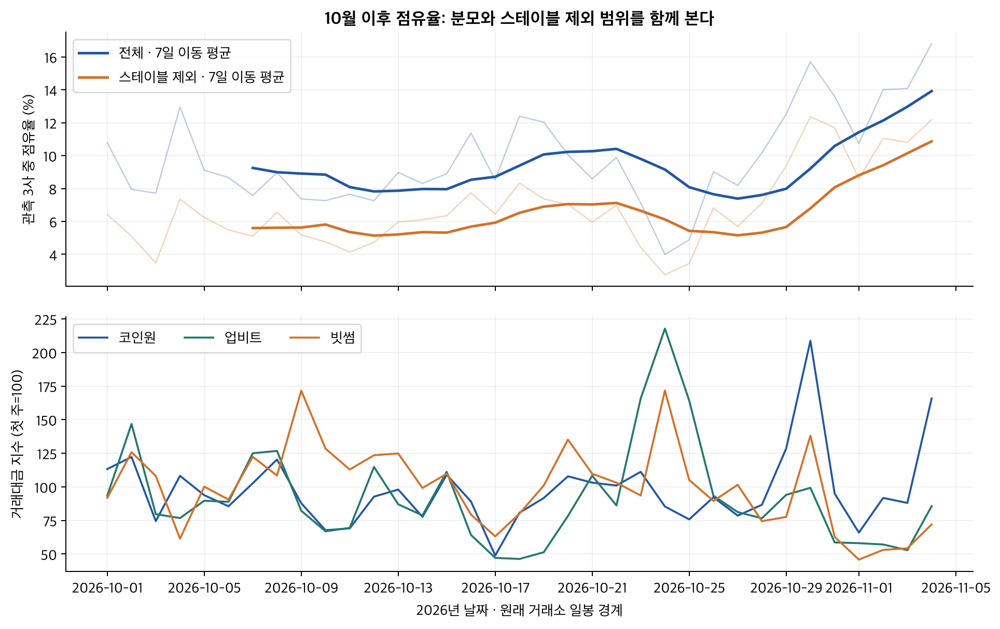
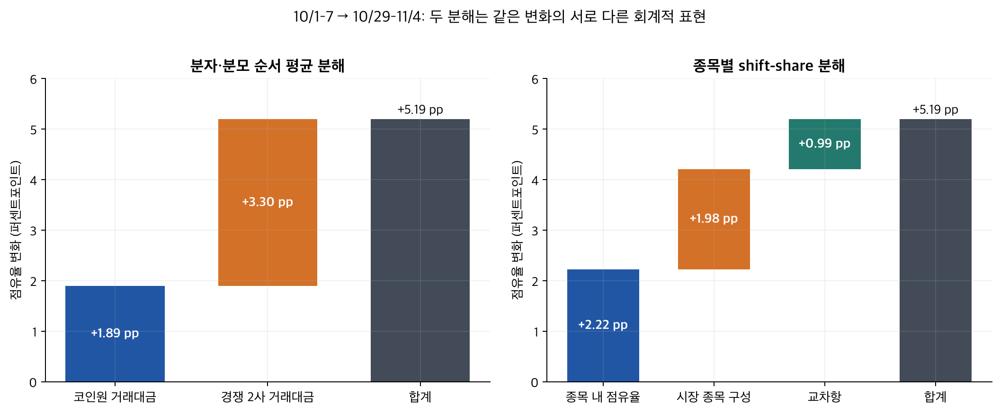
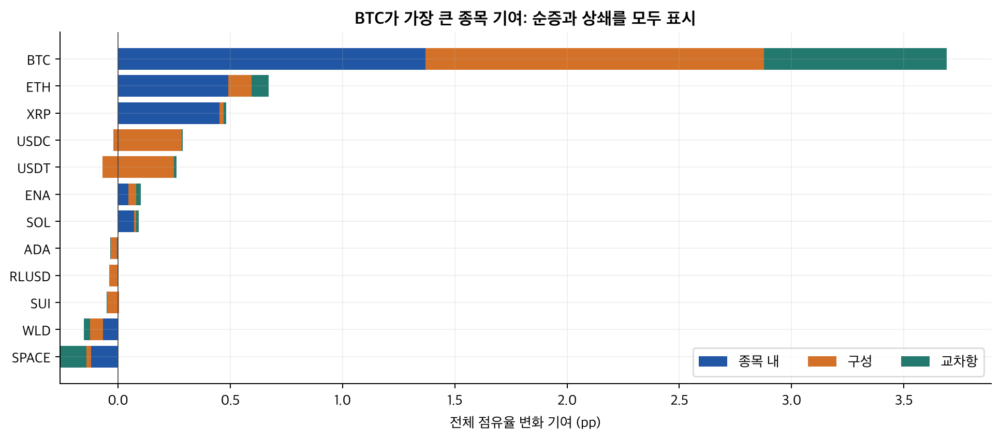
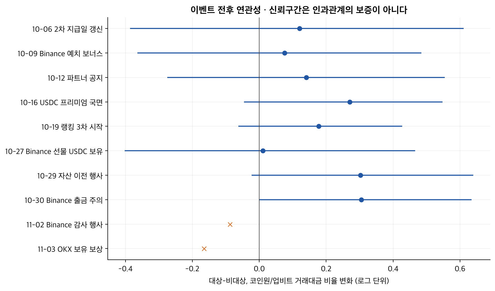
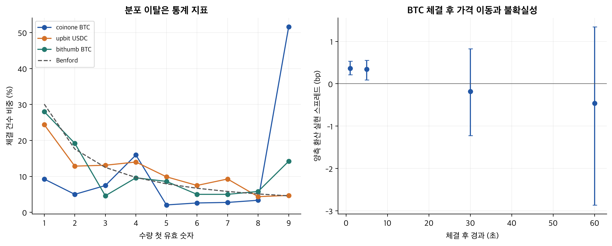
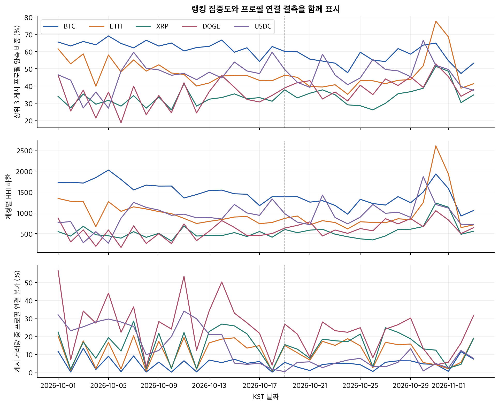
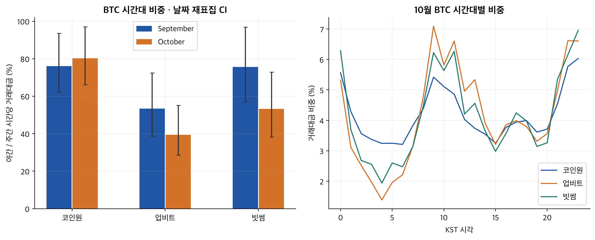
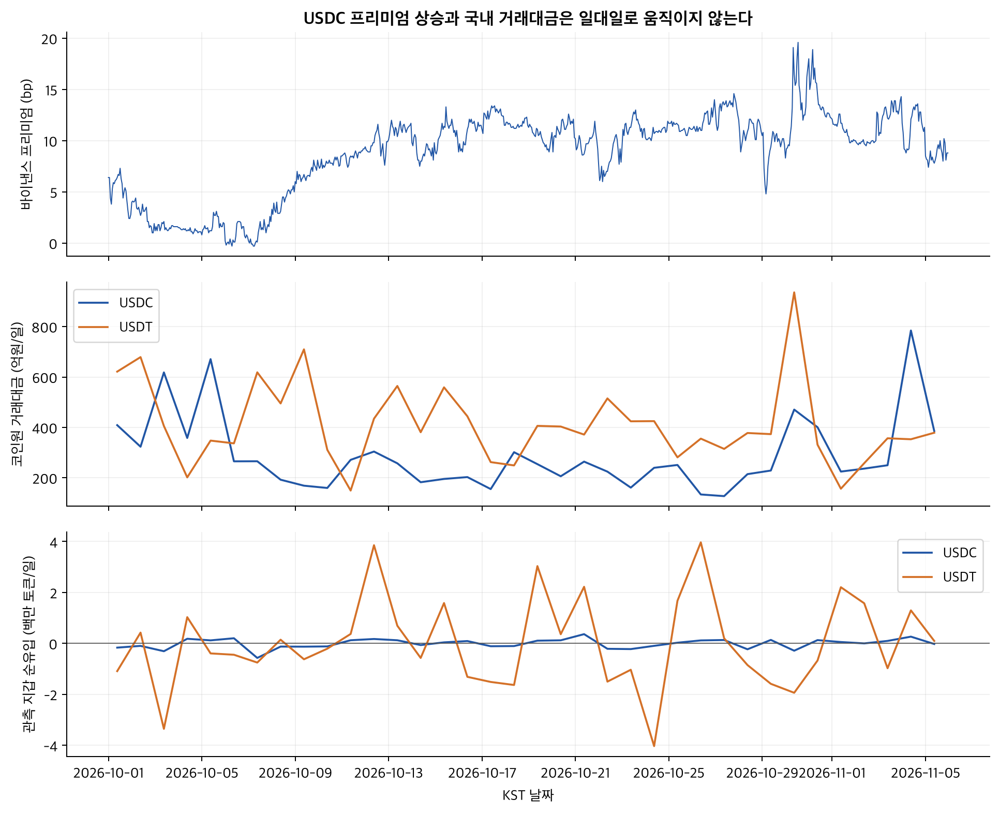

# 코인원 거래량과 점유율 심층 분석

## 개정 이력

- 2026-11-06: 10월 이후 점유율을 분자·분모와 종목 구성으로 분해했다. 9월 기준선, 이벤트 전후 검정, 스테이블코인 경로, 랭킹 집중도, 체결 분포, 호가·체결 후 가격 이동, 인센티브·재무를 재작성했다.
- 2026-11-04: 최초 종합 분석. 아래 정정표가 이전 표현보다 우선한다. 파일 이름은 기존 링크를 유지하기 위해 보존했다.

완료 일봉의 공통 분석 마감은 **2026-11-04**, 시간봉·온체인은 **2026-11-05 KST**, 새로운 호가·체결 표본은 **2026-11-06 새벽의 짧은 관측**이다. 서로 다른 마감의 수치를 같은 하루로 합치지 않았다. 공개 자료로 거래 목적·실소유자·계정 수익을 판정하지 않는다.

## 핵심 결론

관측된 점유율 상승은 BTC의 거래 확대와 경쟁 거래소의 거래대금 감소로 설명되지만, 그 증가분을 개별 행사나 거래 주체의 행동에 인과적으로 배분할 수는 없다.

- **확인됨 · 높은 신뢰:** 관측 3사 중 코인원 점유율은 10/1–7의 9.02%에서 10/29–11/4의 14.21%로 5.19%p 상승했다. 날짜 변동을 반영한 95% 구간은 [3.51 ~ 6.56]%p다. 분자·분모 순서 평균 분해에서는 코인원 거래대금 증가가 1.89%p, 경쟁 2사 거래대금 감소가 3.30%p를 차지한다. 이는 회계적 분해다.
- **확인됨 · 높은 신뢰:** 같은 기간 코인원 BTC의 거래대금 증가 기여는 순증의 120.18%다. 다른 종목의 감소가 이를 상쇄해 기여율이 전체를 넘는다. 스테이블코인 제외 점유율도 5.52%에서 11.03%로 올랐다. “USDC만 늘어서 점유율이 올랐다”는 설명은 이 비교와 맞지 않는다.
- **추정 · 낮은 신뢰:** 무료 거래와 랭킹 보상은 반복 거래의 비용을 낮추는 구조이고, 거래량·표시 프로필 집중은 그 경로와 양립한다. 그러나 랭킹 3차 전후 삼중차분은 사전 추세, 넓은 구간, 겹친 사건 때문에 독립적인 원인 효과로 식별되지 않는다. **행사별 기여율은 모름**이다.
- **확인됨 / 모름 · 구분 필요:** 바이낸스 USDC 프리미엄은 10월 중순 이후 높아졌지만, 국내 가격 차이와 출금료를 빼면 순환 산술의 여유는 작다. 거래량과 프리미엄·지갑 흐름 사이 연관성은 아래에 제시하되, **같은 고객의 KRW→USDC→Binance→USDT→KRW 순환과 그 비중은 모름**이다.
- **확인됨 · 표본 내 높은 신뢰:** 고정 수량 반복, 첫 숫자 분포 이탈, 높은 상위 게시 프로필 비중이 관측된다. 호가 스프레드는 종목에 따라 경쟁력이 있지만 체결 뒤 가격 이동도 크다. 이 지표만으로 자전거래, 특정 운영 주체, 시장조성 이익을 판정할 수 없다.
- **모름 · 자료 한계:** 무료 정책의 실제 포기 수익, 스폰서 분담, 고객별 순입금, 전체 지갑 재고와 원화의 해외 순유출은 공개 자료로 확정되지 않는다. 랭킹 3차 종료 뒤의 판별 기준은 사전에 수치로 고정했다.

## 10월 이후 점유율 상승 원인

10월 첫 주 대비 최근 주의 상승은 코인원의 증가와 경쟁사의 감소가 함께 만든 결과이며, BTC가 가장 큰 종목 기여를 한다.

### 기간과 분모를 먼저 고정한다

이 절의 점유율은 코인원·업비트·빗썸의 **관측 가능한 현재 KRW 마켓 거래대금 합계**를 분모로 한다. “국내 전체” 점유율과 구분한다. 일봉은 코인원·업비트가 UTC 자정, 빗썸은 KST 자정이므로 3사 주간 합계에는 양 끝의 9시간 차이가 남는다. 주간 합계로 경계 영향을 줄이고, UTC가 일치하는 코인원/업비트 및 빗썸 시간봉으로 맞춘 동일 종목 표본을 별도로 확인했다. 상장폐지된 과거 마켓은 현행 목록에서 빠질 수 있어 생존편향이 있다. 미관측은 거래가 없었다는 뜻이 아니다. [코인원 공식 API 문서](https://docs.coinone.co.kr/), [업비트 일봉 문서](https://docs.upbit.com/kr/reference/list-candles-days), [빗썸 API 문서](https://apidocs.bithumb.com/)

| 기간 | 코인원 억원/일 | 업비트 억원/일 | 빗썸 억원/일 | 3사 점유율 % | 스테이블 제외 % | 코인원/(코인원+업비트) % |
| --- | --- | --- | --- | --- | --- | --- |
| 2026-09-01 ~ 2026-09-30 | 1,696.3 | 18,053.2 | 7,238.3 | 6.29 | 3.41 | 8.59 |
| 2026-09-22 ~ 2026-09-30 | 1,823.6 | 21,095.5 | 8,661.0 | 5.77 | 3.77 | 7.96 |
| 2026-10-01 ~ 2026-10-07 | 2,140.0 | 14,996.1 | 6,586.2 | 9.02 | 5.52 | 12.49 |
| 2026-10-29 ~ 2026-11-04 | 2,579.0 | 10,826.9 | 4,737.2 | 14.21 | 11.03 | 19.24 |

*그림 · 10/1–11/4 공개 일봉. 위: 일별 및 일별 점유율의 7일 이동 평균. 아래: 첫 주 평균을 기준으로 한 거래대금 지수. 표의 주간 점유율은 일별 비율 평균이 아니라 합계의 비율이다.*

### 분자·분모와 종목 구성의 두 분해

코인원 거래대금은 20.52% 증가했고 경쟁 2사의 합계는 -27.88% 변했다.

분자·분모 분해는 변경 순서에 따른 차이를 두 순서의 평균으로 배분하는 **Shapley 분해**다. 종목 분해는 전체 점유율을 “종목의 시장 비중 × 해당 종목에서 코인원 비중”의 합으로 쓴 **shift-share**다. 두 방식은 같은 변화를 다르게 설명하므로 서로 더하지 않는다. 이 값은 보상이나 마케팅이 없었을 때의 반사실 효과가 아니다.

| 분해 | 구성요소 | 기여 %p |
| --- | --- | --- |
| 분자·분모 | 코인원 거래대금 증가 | 1.89 |
| 분자·분모 | 경쟁 2사 거래대금 감소 | 3.30 |
| 종목 구성 | 같은 종목 안의 코인원 점유율 변화 | 2.22 |
| 종목 구성 | 전체 시장의 종목 비중 변화 | 1.98 |
| 종목 구성 | 두 변화의 교차항 | 0.99 |
| 각 분해의 합계 | 전체 점유율 변화 | 5.19 |

*그림 · 10/1–7 대 10/29–11/4. 분자·분모 순서 평균과 종목 구성 분해. 출처: 3사 공개 일봉 재계산. 관측 구간의 산술 항등식이며 행사 효과가 아니다.*

| 종목 | 종목 내 이전 % | 이후 % | 종목 내 %p | 구성 %p | 교차 %p | 합계 %p | 코인원 주간 순증 억원 | 전체 순증 기여 % |
| --- | --- | --- | --- | --- | --- | --- | --- | --- |
| BTC | 30.47 | 46.86 | 1.37 | 1.51 | 0.81 | 3.69 | 3,693.3 | 120.2 |
| ETH | 14.57 | 25.11 | 0.49 | 0.11 | 0.08 | 0.67 | 588.6 | 19.2 |
| XRP | 6.81 | 12.20 | 0.45 | 0.02 | 0.01 | 0.48 | 389.4 | 12.7 |
| USDC | 93.83 | 92.76 | -0.02 | 0.31 | 0.00 | 0.28 | -328.3 | -10.7 |
| USDT | 22.13 | 21.36 | -0.07 | 0.33 | -0.01 | 0.25 | -442.6 | -14.4 |
| SPACE | 96.98 | 15.15 | -0.12 | -0.14 | 0.12 | -0.14 | -235.1 | -7.7 |
| WLD | 5.87 | 4.01 | -0.07 | -0.08 | 0.03 | -0.12 | -240.1 | -7.8 |
| ENA | 4.98 | 8.49 | 0.05 | 0.03 | 0.02 | 0.10 | 104.4 | 3.4 |
| SOL | 4.50 | 8.91 | 0.07 | 0.01 | 0.01 | 0.09 | 88.9 | 2.9 |
| SUI | 4.11 | 4.35 | 0.00 | -0.05 | 0.00 | -0.05 | -95.4 | -3.1 |
| RLUSD | 99.24 | 99.57 | 0.00 | -0.04 | 0.00 | -0.04 | -207.3 | -6.7 |
| ADA | 4.67 | 4.33 | 0.00 | -0.03 | 0.00 | -0.03 | -63.1 | -2.1 |

종목 표는 점유율 기여 절댓값 순이다. 순증 기여율은 해당 종목의 코인원 주간 거래대금 변화 ÷ 전체 변화다. 감소한 종목은 음수가 되고 증가 기여의 합은 전체를 넘을 수 있다. USDC의 종목 내 점유율은 내려갔지만 전체 시장에서 이 종목의 비중이 커져 종목 구성 기여는 양수다. 종목 내 점유율 상승도 경쟁사 물량 감소와 코인원 물량 증가를 모두 포함한다.

*그림 · 종목별 점유율 변화의 누적 구성. 10/1–7 대 10/29–11/4, 3사 공개 일봉. BTC·ETH·XRP와 비대상 종목을 함께 표시했다.*

### 일회성 급증을 빼도 남는가

10/30 하루만으로 상승을 설명할 수는 없지만, 그날을 빼면 코인원 거래대금 증가폭은 줄어든다.

10/30을 최근 주에서 제외하고 기준도 같은 길이인 10/2–7로 맞추면 점유율 변화는 5.04%p, 코인원 거래대금 증가는 8.19%, 경쟁사 변화는 -35.15%다. 이 비교에서는 분자 기여 0.78%p보다 분모 기여 4.26%p가 크다. 과거 보고서의 “급증일 제외 약 보합”은 직전 주 비교였으며 이 기간과 다르다.

업비트 IRYS의 최대 거래일은 2026-10-23이고 거래대금은 8,274.6억원이다. 이런 신규 상장 종목은 중간 주의 분모를 크게 흔들 수 있다. IRYS를 모든 거래소에서 제외한 첫 주 대 최근 주 점유율 변화는 5.40%p다. 두 끝 주 밖의 급증을 전체 추세의 원인으로 옮겨 말하지 않았다. [업비트 IRYS 공식 자산 정보](https://datalab.upbit.com/assets/IRYS/summary)

비대상 종목도 개별 보상을 받았다. 예를 들어 SPACE의 10월 거래대금 상위 일자는 아래 방법 부록에 남겼고, 10월 중순 목요 코인 페스타와 시기가 겹친다. 따라서 비랭킹 종목을 모두 “보상 없는 집단”으로 간주할 수 없다. [코인원 SPACE 행사 공지 5854](https://coinone.co.kr/info/notice/5854)

### 이벤트 달력과 인과 식별

여러 행사가 겹치고 무료 거래가 분석 시작 전부터 유지되어, 행사별 효과를 분리할 깨끗한 대조군이 없다.

이벤트 스터디는 사건 전후의 변화를 비교한다. 차분의 차분은 코인원과 비교 거래소의 상대 변화를 비교하고, 삼중차분은 여기서 랭킹 대상과 비대상 종목의 차이까지 뺀다. 여기서는 각 종목의 코인원/비교 거래소 거래대금 비율에 로그를 취한 뒤, 대상과 대조군의 평균 격차 변화를 계산했다. 비슷한 사전 추세가 있어야 원인 효과로 해석하기 쉬우나 이 조건은 충족되지 않았다.

| KST 시점 | 확인한 사실과 경로 | 식별상 문제·출처 |
| --- | --- | --- |
| 10/6 | 2차 상금 지급 주기를 늦추는 갱신 | 거래 요율 변경과 구분. [5774](https://coinone.co.kr/info/notice/5774) |
| 10/9 | Binance USDC 유연 예치 보너스 | 프리미엄 변화의 가능한 수요 경로. [공식 공지](https://www.binance.com/en/support/announcement/detail/aa50d46ffef448f98c42f9272fcee663) |
| 10/12 | 한국투자증권·OKX 파트너 공개 | 기존 투자와 발표 시점 구분. 공동 호가 공급은 미확인. [5844](https://coinone.co.kr/info/notice/5844) |
| 10/16 부근 | 관측된 Binance USDC 프리미엄 국면 변화 | 행사 시작일이 아니라 가격 자료에서 정한 맥락 날짜. 9/22 Circle 계약 연장은 선행 배경. [Circle 공식 발표](https://www.circle.com/fr/pressroom/binance-invests-100-million-in-circle-expands-strategic-partnership-and-renews-commercial-agreement-for-five-years) |
| 10/18 종료 → 10/19 시작 | 랭킹 2차에서 3차로 공백 없이 전환 | 종목·일일 상금 구조 유지. 0%는 새 처치가 아니다. [5774](https://coinone.co.kr/info/notice/5774), [5850](https://coinone.co.kr/info/notice/5850) |
| 10/19 예정 02–08시 | 업비트 서버 점검으로 거래 중단 공지 | 동시 충격. 시간대 비교에서 결측일 제외. [공식 점검 공지](https://docs.upbit.com/kr/changelog/server_maintenance_1019) |
| 10/23 | 업비트 IRYS 거래 급증 | 신규 상장·거래소 종목 구성의 분모 효과. 위 자산 정보와 일봉 대조 |
| 10/27 | Binance USDC 선물 지갑 보유 보상 | 스테이블 수요 경로와 혼재. [공식 공지](https://www.binance.com/en/support/announcement/detail/2f1961e25f5a4412a937e78114ad5fce) |
| 10/29 16시 | 타 국내 거래소에서 코인원으로 이전 행사 | API 거래 제외. 수집한 전체 거래량과 처치 모집단이 다름. [5896](https://coinone.co.kr/info/notice/5896) |
| 10/29 사건 · 10/30 08시 주의 | Binance 관련 사건과 코인원 출금 주의 | 이전 행사·가격 변동이 겹침. 사건과 공지일을 구분. [5899](https://coinone.co.kr/info/notice/5899) |
| 11/2 20:30 시작 | Binance Community Appreciation | 10월 초 상승을 설명할 수 없는 사후 행사. [공식 공지](https://www.binance.com/en/support/announcement/detail/dad3f7336cd343fd9752c63b21f8d52a) |
| 11/3 09시 시작 | OKX Hold-to-Earn USDC | 사후 완료 일봉이 매우 적다. [공식 조건](https://www.okx.com/help/hold-to-earn-usdc-to-share-400000-usdc) |
| 10월 내 경쟁 요율 | 빗썸 종료 갱신과 무료 안내 잔존, 이용자별 환급 | 개별 실효 수수료 미상. [종료 갱신](https://feed.bithumb.com/notice/1654522), [별도 무료 안내](https://feed.bithumb.com/notice/1654656) |

| 사건 | 삼중차분 로그 변화 | 95% 구간 | 전/후 일수 | 사전 추세 p | 가짜 종목 p | 한 종목 제외 범위 |
| --- | --- | --- | --- | --- | --- | --- |
| 10-06 2차 지급일 갱신 | 0.120 | [-0.385 ~ 0.610] | 7 / 7 | <0.001 | 0.630 | 0.071 ~ 0.199 |
| 10-09 Binance 예치 보너스 | 0.076 | [-0.363 ~ 0.483] | 7 / 7 | 0.372 | 0.762 | 0.015 ~ 0.148 |
| 10-12 파트너 공지 | 0.141 | [-0.273 ~ 0.553] | 7 / 7 | 0.923 | 0.713 | 0.074 ~ 0.202 |
| 10-16 USDC 프리미엄 국면 | 0.270 | [-0.044 ~ 0.546] | 7 / 6 | 0.398 | 0.468 | 0.188 ~ 0.329 |
| 10-19 랭킹 3차 시작 | 0.178 | [-0.061 ~ 0.426] | 7 / 6 | 0.365 | 0.468 | 0.132 ~ 0.244 |
| 10-27 Binance 선물 USDC 보유 보상 | 0.011 | [-0.401 ~ 0.464] | 6 / 7 | 0.004 | 0.973 | -0.047 ~ 0.131 |
| 10-29 자산 이전 캠페인 | 0.303 | [-0.021 ~ 0.638] | 6 / 6 | 0.434 | 0.375 | 0.238 ~ 0.390 |
| 10-30 Binance 출금 주의 | 0.305 | [0.001 ~ 0.633] | 6 / 5 | 0.032 | 0.365 | 0.241 ~ 0.371 |
| 11-02 Binance 감사 행사 | -0.088 | 산출 유보 | 7 / 2 | 0.131 | 0.810 | -0.255 ~ 0.000 |
| 11-03 OKX 보유 보상 | -0.166 | 산출 유보 | 7 / 1 | <0.001 | 0.767 | -0.538 ~ 0.043 |

대조군은 9월 거래대금으로 선정한 공통 비랭킹·비스테이블 종목이다. 업비트 기준 주 비교 삼중차분은 0.317, 95% 구간 [-0.205 ~ 0.778]다. 9월 사전 추세는 하루 -0.032 로그 단위, 구간 [-0.048 ~ -0.016]여서 평행 추세 가정이 약하다. 빗썸을 정확히 UTC로 맞추고 완전한 시간봉이 있는 대조군만 쓰면 0.166, 구간 [-0.290 ~ 0.572]다. 표의 계수는 서로 겹치는 창의 연관성이고 더할 수 없다. 가짜 날짜·가짜 종목·한 종목 제외 결과는 [방법 부록](coinone-methods-20261106.md)에 모두 제시했다. 사건을 여러 번 검정했으므로 일부 구간이 영을 제외해도 독립적인 인과 증거로 취급하지 않았다.

*그림 · 10월 이후 이벤트와 대상/비대상 상대 거래대금 격차. 업비트 UTC 기준, 날짜 블록 95% 구간. 동시 사건·비평행 사전 추세·사후 짧은 표본을 반영해 인과 기여율로 해석하지 않는다.*

### 스테이블 경로·집중도·시간대의 교차 확인

스테이블 수요와 자동화 거래에 부합하는 패턴은 있으나, 점유율 순증을 그 경로의 물량으로 곧바로 바꿀 수 없다.

2026-10-01–2026-10-15: Binance USDC/USDT 프리미엄 중앙값 5.70bp, 코인원 USDC 하루 평균 309.6억원, USDT 454.4억원이다.

2026-10-16–2026-10-28: Binance USDC/USDT 프리미엄 중앙값 11.20bp, 코인원 USDC 하루 평균 210.6억원, USDT 371.6억원이다.

2026-10-29–2026-11-05: Binance USDC/USDT 프리미엄 중앙값 10.85bp, 코인원 USDC 하루 평균 372.7억원, USDT 393.0억원이다.

완료 랭킹 게시판의 마지막 주인 10/28–11/3에서, 같은 종목의 9월 게시판에서 보였던 연결 가능 프로필은 게시 거래량의 59.14%, 2차 기간에 한 번이라도 보였던 프로필은 90.84%다. 프로필 연결 불가 비중은 6.61%다. 새로 상위에 나타난 프로필도 있지만 신규 고객이나 독립된 실소유자라고 해석할 수 없다. 기존 참여자의 연속성이 큰 것과 9월 대비 구성 교체가 있는 것은 동시에 성립한다.

**판정:** **확인됨(높은 신뢰)** — 분모 감소와 BTC 중심의 분자 확대가 관측 점유율 상승을 설명한다. **추정(낮은 신뢰)** — 무료 거래·보상 구조와 기존 게시 프로필의 높은 연속성은 거래비용에 민감한 반복 활동 경로에 부합한다. **모름** — 랭킹 전환, 파트너 공지, 해외 USDC 보상과 사건 각각의 독립 효과·순환 거래 비중·거래 주체. 시간대와 지갑 흐름을 더해도 이 식별 한계는 해소되지 않는다.

## 목차

- [거래량 품질과 공개 랭킹](#거래량-품질과-공개-랭킹)
- [호가·체결 품질과 시장조성 경제성](#호가체결-품질과-시장조성-경제성)
- [스테이블코인 가격·대량 체결·순환 경로](#스테이블코인-가격대량-체결순환-경로)
- [온체인 흐름과 관측 재고 회전](#온체인-흐름과-관측-재고-회전)
- [보상·수수료·재무](#보상수수료재무)
- [종료 이후의 사전 판별 기준](#종료-이후의-사전-판별-기준)
- [정정·한계·출처](#정정한계출처)
- [별도 방법·일별·강건성 부록](coinone-methods-20261106.md)

## 거래량 품질과 공개 랭킹

체결 분포와 집중도는 거래의 생성 방식을 살피는 단서이며, 위법 행위나 허수 거래의 판정식은 아니다.

### 첫 유효 숫자·둥근 크기·꼬리 분포

BTC의 과거 짧은 표본에는 동일 수량이 많이 반복되지만, 종목·시간대·거래소마다 분포가 다르다.

**Benford 법칙**은 넓은 크기 범위에서 첫 유효 숫자가 균등하지 않고 작은 숫자가 더 자주 나타난다는 기준이다. **MAD**는 실제 숫자 비율과 이 기준의 평균 절대 차이다. 여기서는 수량과 원화 체결금액을 각각 검사했다. 주문 최소금액, 가격 단위, 정액 주문, 알고리즘의 크기 분할만으로도 기준에서 벗어날 수 있다. 카이제곱 검정은 독립 표본을 가정하므로, 연속 체결에서는 매우 작은 p값을 행위 판정으로 해석하면 안 된다. 다중 검정의 BH 보정도 이 근본적인 모형 불일치를 고치지 못한다.

**꼬리 지수 α**는 표본 상위 크기의 생존확률을 거듭제곱 형태로 맞춘 지표다. 값이 작을수록 큰 체결의 비중이 천천히 줄어드는 모양이다. 상위 분위수의 후보 꼬리에만 적용했고, 이산 크기 반복·짧은 표본 때문에 멱법칙 자체가 성립한다고 확정하지 않았다. Cong 외 논문이 사용하는 여러 통계적 진단의 취지를 따르되, 논문의 다른 거래소 추정치를 이 거래소에 이식하지 않았다. [출판 논문 DOI](https://doi.org/10.1287/mnsc.2021.02709), [NBER 원 논문](https://www.nber.org/system/files/working_papers/w30783/w30783.pdf)

| 표본 | KST 시작~끝 (월-일 시:분) | 체결 수 | 관측 분 | 수량 MAD | MAD 95% 구간 | 원화 MAD | 수량 꼬리 α | α 95% 구간 |
| --- | --- | --- | --- | --- | --- | --- | --- | --- |
| 코인원 BTC | 11-04T15:14 ~ 11-04T15:22 | 2,000 | 9 | 0.118 | [0.107 ~ 0.127] | 0.118 | 1.63 | [1.42 ~ 1.85] |
| 코인원 USDC | 11-04T14:25 ~ 11-04T15:18 | 2,000 | 46 | 0.028 | [0.023 ~ 0.034] | 0.024 | 3.14 | [2.42 ~ 5.39] |
| 업비트 USDC | 10-29T09:02 ~ 11-06T01:07 | 17,298 | 3,795 | 0.025 | [0.023 ~ 0.028] | 0.026 | 1.36 | [1.29 ~ 1.46] |
| 업비트 USDT | 10-29T09:00 ~ 11-06T01:07 | 328,277 | 11,015 | 0.015 | [0.014 ~ 0.016] | 0.016 | 1.16 | [1.14 ~ 1.18] |
| 업비트 USDC | 11-04T14:27 ~ 11-04T15:18 | 51 | 21 | 0.041 | [0.034 ~ 0.074] | 0.041 | 유보 | 유보 |
| 빗썸 BTC | 11-06T01:30 ~ 11-06T01:36 | 500 | 7 | 0.028 | [0.025 ~ 0.037] | 0.031 | 1.66 | [1.42 ~ 2.31] |
| 빗썸 USDC | 11-06T00:01 ~ 11-06T01:35 | 500 | 63 | 0.026 | [0.015 ~ 0.041] | 0.017 | 1.75 | [1.30 ~ 2.47] |
| 빗썸 USDT | 11-06T01:24 ~ 11-06T01:36 | 500 | 13 | 0.096 | [0.046 ~ 0.123] | 0.101 | 0.74 | [0.49 ~ 1.01] |

업비트 완료 과거 체결 표본과 빗썸 최근 체결 표본은 같은 기간의 무작위 추출이 아니다. USDC의 동일 시계 비교도 업비트 표본이 작아 검정력이 낮다. 코인원 BTC와 업비트 BTC의 동일 기간 체결 분포 비교는 확보하지 못했다. 새 호가·체결 표본의 랭킹/비랭킹 및 업비트 USDC·USDT 비교 전체와 원화 반올림 비율은 별도 부록에 제시한다. 크기·창이 다른 표본의 MAD나 α 차이를 거래소별 품질 순위로 쓰지 않는다.

11/4 코인원 BTC 2,000건은 455.449초, 5.638억원이다. 수량 0.00095501 BTC가 936건(46.8%), 0.00477509 BTC가 228건(11.4%)이다. 이는 **고정 수량 반복**이다. 가격이 움직이므로 항상 정확히 같은 원화 금액을 주문했다는 뜻은 아니다. 고정 수량 전략·정액 기능·다양한 자동화 전략으로도 이런 군집이 생길 수 있다.

*그림 · 첫 유효 숫자 분포와 BTC 체결 뒤 실현 스프레드. 출처: 공개 체결·직전 호가. 표본 창은 위 표와 시장 품질 표에 명시. 분포 이탈이나 음의 실현 스프레드는 위법 행위 판정이 아니다.*

### 랭킹의 양측 합계와 매칭 하한

랭킹 합계가 시장 거래대금을 넘는 현상은 매수·매도가 각각 집계되기 때문에 생기며, 동일인 거래를 뜻하지 않는다.

시장 체결대금 V는 한 체결을 한 번 센 값이다. 각 프로필의 매수와 매도 금액을 더한 랭킹 합계 S는 양측 기준이다. 따라서 상위 집합의 거래 관여 비중은 S/(2V)다. 상위 집합 밖의 한쪽과 거래해 만들 수 있는 양측 점수는 최대 V이므로, **상위 집합 내부의 양측이 만난 체결대금 하한은 max(0, S−V)**다. 이것이 비둘기집 원리의 하한이다. 상대가 같은 소유자인지, 정상적인 독립 참여자인지, 동일 계정인지는 이 식에서 나오지 않는다. [공식 랭킹 집계 조건 5713](https://coinone.co.kr/info/notice/5713), [3차 약관 5850](https://coinone.co.kr/info/notice/5850)

| 11/3 종목 | 시장 억원 | 상위1 양측 % | 상위3 % | 상위10 % | 상위50 % | 상위3 내부 하한 % | 상위50 내부 하한 % | HHI 하한 | HHI 상한 | 게시50 Gini |
| --- | --- | --- | --- | --- | --- | --- | --- | --- | --- | --- |
| BTC | 793.7 | 19.40 | 53.19 | 76.03 | 80.47 | 6.39 | 60.95 | 1,056 | 1,437 | 0.864 |
| DOGE | 29.1 | 16.33 | 37.95 | 62.04 | 81.35 | 0.00 | 62.71 | 645 | 993 | 0.679 |
| ETH | 159.3 | 17.42 | 41.32 | 68.09 | 76.42 | 0.00 | 52.84 | 713 | 1,269 | 0.794 |
| USDC | 250.0 | 20.24 | 37.47 | 66.96 | 87.09 | 0.00 | 74.17 | 718 | 885 | 0.731 |
| XRP | 191.9 | 17.63 | 34.78 | 58.77 | 65.85 | 0.00 | 31.70 | 559 | 1,725 | 0.812 |

위 계산은 완료된 345개 날짜×종목 게시판, 69일에서 k별 17,250개 행으로 재계산했다. 시작일 부분 시간과 미완료 일자를 제외했다. 랭킹에 참여 등록하지 않은 계정은 게시판에 없을 수 있어 “거래소의 진짜 상위 계정” 명단으로 취급하지 않는다.

**HHI**는 전체 양측 점유율의 제곱합으로 집중도를 나타낸다. 게시 프로필 제곱합을 하한으로 두고, 미표시 잔여량이 하나에 모인 경우를 보수적 상한으로 둔다. **Gini**는 값의 불균등 정도이며 이 문서의 Gini는 표시된 프로필에만 적용한다. 실제 고객 전체의 Gini가 아니다. 연결 식별자 누락은 한 명으로 합치지 않았다. 같은 표시가 같거나 달라졌다는 사실과 실소유자 수는 별개다.

| 단계·종목 | 완료 기간 | 일수 | 상위3 일별 비중 평균 % | 날짜 블록 95% 구간 | HHI 하한 중앙값 | 표시50 Gini 중앙값 |
| --- | --- | --- | --- | --- | --- | --- |
| 2차 BTC | 2026-09-21 ~ 2026-10-18 | 28 | 61.38 | [57.26 ~ 64.09] | 1,476 | 0.895 |
| 2차 ETH | 2026-09-21 ~ 2026-10-18 | 28 | 45.65 | [39.13 ~ 51.10] | 853 | 0.831 |
| 2차 XRP | 2026-09-21 ~ 2026-10-18 | 28 | 28.79 | [26.03 ~ 31.74] | 438 | 0.815 |
| 2차 DOGE | 2026-09-21 ~ 2026-10-18 | 28 | 32.17 | [29.64 ~ 34.94] | 502 | 0.758 |
| 2차 USDC | 2026-09-21 ~ 2026-10-18 | 28 | 41.79 | [37.85 ~ 46.19] | 802 | 0.789 |
| 3차 BTC | 2026-10-19 ~ 2026-11-03 | 16 | 57.33 | [54.27 ~ 60.17] | 1,274 | 0.870 |
| 3차 ETH | 2026-10-19 ~ 2026-11-03 | 16 | 50.00 | [40.60 ~ 59.50] | 799 | 0.815 |
| 3차 XRP | 2026-10-19 ~ 2026-11-03 | 16 | 35.60 | [31.83 ~ 39.48] | 572 | 0.814 |
| 3차 DOGE | 2026-10-19 ~ 2026-11-03 | 16 | 39.34 | [36.77 ~ 42.17] | 656 | 0.721 |
| 3차 USDC | 2026-10-19 ~ 2026-11-03 | 16 | 48.81 | [44.25 ~ 53.25] | 939 | 0.781 |

*그림 · 10/1–11/3 완료 게시판의 일별 상위 비중·HHI 하한·연결 결측. 출처: 공식 공개 랭킹과 같은 KST일 시장 거래대금. 실소유자는 식별하지 않는다.*

### 야간 거래는 자동화의 보조 지표다

코인원 BTC의 야간 상대 비중은 두 달 사이 크게 달라졌다고 단정하기 어렵지만, 경쟁 거래소와 다른 시간대 모양이 관측된다.

야간은 KST 02–06시, 주간은 09–18시다. 길이가 다르므로 합계가 아닌 **시간당 평균의 비율**을 사용했다. 날짜를 묶어 재표집한 신뢰구간을 표시한다. 업비트 점검일처럼 필요한 시간봉이 빠진 일자는 이 비율에서 제외했다. 24시간 해외 가격 반응, 국내 이용자의 시간대 선호, 정액 주문도 야간 거래를 만들 수 있어 야간 비중을 봇 거래 비율로 바꿀 수 없다.

| 거래소 | 월 | 완전 관측 일수 | 야간 억원/시간 | 주간 억원/시간 | 야간/주간 % | 95% 구간 |
| --- | --- | --- | --- | --- | --- | --- |
| 코인원 | 9/1–30 | 30 | 7.47 | 9.82 | 76.0 | [62.2 ~ 93.6] |
| 코인원 | 10/1–31 | 31 | 23.65 | 29.48 | 80.2 | [66.1 ~ 97.2] |
| 업비트 | 9/1–30 | 30 | 23.43 | 43.86 | 53.4 | [38.7 ~ 72.5] |
| 업비트 | 10/1–31 | 30 | 17.01 | 43.06 | 39.5 | [28.6 ~ 55.1] |
| 빗썸 | 9/1–30 | 30 | 13.55 | 17.91 | 75.6 | [57.2 ~ 97.0] |
| 빗썸 | 10/1–31 | 31 | 8.93 | 16.77 | 53.2 | [38.2 ~ 73.0] |

*그림 · 2026년 9월·10월 BTC 시간봉. 출처: 3사 공개 캔들. 비율은 시간당 평균, 오른쪽 시간대 분포는 월별 시간당 평균을 정규화했다.*

## 호가·체결 품질과 시장조성 경제성

좁은 표시 스프레드는 유동성의 한 측면이며, 충분한 깊이와 체결 뒤 가격 이동까지 함께 봐야 한다.

### 표시 호가와 관측 깊이

BTC에서 코인원 표시 스프레드가 빗썸보다 좁은 창이 관측됐지만, 종목·시각·호가 수 차이가 있어 거래소 전체의 우열로 일반화할 수 없다.

**표시 스프레드**는 최우선 매도·매수 가격 차이를 중간가격으로 나눈 값이다. bp는 가격의 만분의 일이다. **깊이**는 중간가격에서 지정 거리 안의 매수·매도 호가 원화 합계다. 저장한 호가 층이 거리 끝에 닿지 않으면 계산값은 하한이다. 특히 과거 상위 호가만으로 먼 거리의 전체 깊이를 안다고 표기하지 않았다.

| 11/4 14:52–17:10 KST | 유효 초 수 | 중앙 스프레드 bp | 평균 bp | 평균 95% 구간 | 작은 쪽 최우선 만원 | 10bp 매수 만원 | 10bp 매도 만원 | 범위 전체 관측 % |
| --- | --- | --- | --- | --- | --- | --- | --- | --- |
| 코인원 BTC | 8,272 | 0.95 | 1.00 | [1.00 ~ 1.01] | 637.8 | 6,632.1 | 8,775.9 | 0.0 |
| 빗썸 BTC | 8,240 | 3.24 | 3.28 | [3.07 ~ 3.48] | 52.3 | 1,878.1 | 2,242.6 | 0.0 |
| 코인원 ETH | 8,230 | 3.24 | 3.49 | [3.43 ~ 3.56] | 409.5 | 5,238.8 | 11,059.9 | 100.0 |
| 빗썸 ETH | 8,280 | 6.45 | 5.14 | [4.95 ~ 5.33] | 179.0 | 10,102.1 | 8,350.5 | 100.0 |
| 코인원 USDC | 2,160 | 7.43 | 7.61 | [7.49 ~ 7.78] | 978.3 | 6,179.1 | 9,402.7 | 100.0 |
| 코인원 USDT | 4,037 | 7.44 | 7.44 | [7.44 ~ 7.44] | 34,538.3 | 79,078.9 | 42,803.7 | 100.0 |
| 빗썸 USDT | 7,057 | 7.44 | 7.44 | [7.44 ~ 7.44] | 132,637.0 | 232,278.6 | 137,816.8 | 100.0 |

과거 깊이 표의 BTC는 범위 전체 관측률이 낮으므로 “전체 깊이”가 아닌 관측 하한이다. 두 거래소 데이터는 같은 시계 구간을 썼지만 수신 간격과 호가 갱신 구조가 다르다. 평균의 구간은 초 단위 시계열을 분 블록으로 재표집한 조건부 변동 구간이다.

| 11/6 KST | 관측 창 | 최대 매수/매도 층 | 유효 초 | 중앙 bp | ±10bp 매수/매도 만원 | ±25bp 만원 | ±50bp 만원 | 각 거리 완전 관측 % |
| --- | --- | --- | --- | --- | --- | --- | --- | --- |
| 코인원 BTC | 01:10:15~01:53:41 | 16/16 | 2,432 | 0.96 | 5,491.6 / 8,255.4 | 16,345.7 / 18,849.6 | 16,403.6 / 18,851.1 | 100.0 / 0.3 / 0.0 |
| 코인원 ETH | 01:30:19~01:53:55 | 16/16 | 1,246 | 3.25 | 4,758.2 / 6,708.6 | 14,614.0 / 10,162.3 | 17,738.3 / 12,626.3 | 100.0 / 100.0 / 100.0 |
| 코인원 XRP | 01:33:23~01:53:51 | 16/16 | 1,227 | 5.90 | 8,266.0 / 7,068.9 | 41,657.0 / 11,305.3 | 46,983.6 / 14,148.9 | 100.0 / 100.0 / 100.0 |
| 코인원 USDC | 01:10:15~01:53:28 | 16/16 | 960 | 7.36 | 3,432.4 / 1,379.3 | 13,047.5 / 3,368.6 | 24,907.9 / 7,052.3 | 100.0 / 100.0 / 100.0 |
| 코인원 USDT | 01:10:15~01:54:05 | 16/16 | 1,955 | 7.37 | 16,794.5 / 17,911.5 | 58,118.0 / 57,583.3 | 92,089.7 / 76,068.3 | 100.0 / 100.0 / 100.0 |
| 업비트 USDC | 01:10:15~01:54:08 | 30/30 | 1,962 | 14.72 | 14.5 / 2,056.9 | 4,450.8 / 6,699.2 | 5,098.2 / 7,766.6 | 100.0 / 100.0 / 100.0 |
| 업비트 USDT | 01:10:15~01:54:10 | 30/30 | 2,615 | 7.37 | 35,819.1 / 38,427.0 | 186,557.8 / 124,738.7 | 285,313.5 / 245,230.3 | 100.0 / 100.0 / 100.0 |

새 표본도 실제 저장된 층수의 한계가 있다. 이름이 “전체 호가 수집”이어도 각 메시지에 저장된 최외곽 가격을 검사해 범위 완전성을 판정했다. 거래 없는 시점과 연결 공백은 무조건 같은 시장 상태로 이어 붙이지 않았다. 업비트 BTC 등 확보하지 못한 동시 호가는 빈칸을 만들어 비교하지 않는다.

### 유효·실현 스프레드와 역선택

BTC의 체결 시점 스프레드 일부는 이후 중간가격 이동으로 소진되며, 긴 시계의 실현 스프레드는 불확실하다.

매수 주도 체결의 방향을 양수로 두고 직전 중간가격과 비교한다. **유효 스프레드**는 체결가가 직전 중간가격에서 얼마나 멀었는지, **실현 스프레드**는 일정 시간 뒤 중간가격에 비해 얼마를 남겼는지, **역선택**은 그 사이 중간가격이 체결 방향으로 얼마나 움직였는지다. 모두 양측 환산으로 정의해 유효 = 실현 + 역선택이 성립한다. 방향은 원 API 필드만 믿지 않고 직전 호가로 추정했다. 중간가 체결·오래된 호가·연결 경계를 건너는 표본은 제외했다.

| 11/4 BTC 경과 초 | 분류 가능 체결 | 관측 분 | 유효 bp | 실현 bp | 실현 95% 구간 | 역선택 bp |
| --- | --- | --- | --- | --- | --- | --- |
| 1 | 1,951 | 9 | 0.990 | 0.365 | [0.214 ~ 0.533] | 0.625 |
| 5 | 1,951 | 9 | 0.990 | 0.341 | [0.092 ~ 0.554] | 0.650 |
| 30 | 1,951 | 9 | 0.990 | -0.181 | [-1.223 ~ 0.826] | 1.172 |
| 60 | 1,951 | 9 | 0.990 | -0.460 | [-2.859 ~ 1.343] | 1.450 |

이 표의 실현 스프레드는 수수료·헤지·재고비용 전의 양측 환산 값이다. 시장조성자가 한 번 체결해 얻는 중간가 대비 금액은 이 정의의 절반에 해당한다. 거래 방향 분류 지연을 바꾼 결과와 새 표본의 여러 종목·업비트 비교는 부록에 남겼다. 실제 주문 주체, 헤지 거래, 보유 재고, 주문 우선순위와 미체결은 관측하지 못했으므로 이 값에서 계정 이익을 산출하지 않는다.

### 가격 충격·회복·메시지 대비 체결

짧은 새 표본에서 가격 충격과 호가 회복을 측정할 수 있으나, 장기간 평균이나 주문 취소율을 뜻하지 않는다.

**Kyle의 λ**는 분별 가격 변화와 방향을 붙인 순체결대금 사이 회귀 기울기다. **Amihud 지표**는 절대 수익률을 거래대금으로 나눈 값이다. 변동성과 거래대금이 함께 늘 때도 커질 수 있다. **회복 시간**은 관측 깊이가 급감한 뒤 이전 수준 근처로 돌아오는 시간이며, 감소가 실제 체결인지 주문 취소인지는 구분하지 못한다. **메시지/체결 비율**은 저장된 호가 메시지 수를 같은 구간 체결 수로 나눈 값으로, 주문/취소 건수 비율과 다르다. [Kyle 원 논문](https://doi.org/10.2307/1913210), [Amihud 원 논문](https://doi.org/10.1016/S1386-4181(01)00024-6)

| 11/6 새 표본 | 체결 건 | 회귀 분 | λ bp/억원 | HAC 95% 구간 | Amihud 중앙값 bp/억원 | 호가 메시지/체결 | 거래대금/관측10bp 깊이 배 |
| --- | --- | --- | --- | --- | --- | --- | --- |
| 코인원 BTC | 12,078 | 38 | 13.58 | [5.14 ~ 22.01] | 4.90 | 1.74 | 35.6 |
| 코인원 ETH | 5,341 | 19 | 35.04 | [-4.63 ~ 74.70] | 31.97 | 1.54 | 17.4 |
| 코인원 XRP | 2,065 | 19 | 7.61 | [-29.50 ~ 44.71] | 52.28 | 3.20 | 5.5 |
| 코인원 USDC | 609 | 부족 | 유보 | 유보 | 유보 | 2.10 | 12.2 |
| 코인원 USDT | 1,956 | 23 | 2.98 | [0.59 ~ 5.36] | 0.00 | 1.72 | 8.4 |
| 업비트 USDC | 178 | 16 | -5.59 | [-10.73 ~ -0.44] | 3.91 | 11.43 | 11.9 |
| 업비트 USDT | 3,922 | 43 | 0.47 | [-0.52 ~ 1.47] | 0.00 | 1.80 | 9.6 |

깊이 대비 회전은 해당 체결 창의 전체 거래대금 ÷ 관측 양쪽 깊이 중앙값이다. 깊이가 하한이면 이 회전 값은 전체 깊이 기준 회전의 상한에 가깝다. 초당 수신 신선도 필터를 통과한 표본만 쓰며, 짧은 연결 끊김·교차 시계 오차는 남을 수 있다. 거래대금–변동성·스프레드 상관과 회복 사건 수는 부록에 제시했다. 여러 지표를 함께 볼 수 있지만 하나의 품질 점수로 합산하지 않았다.

## 스테이블코인 가격·대량 체결·순환 경로

국내외 가격 차이는 연결되지만, 대량 체결과 운영 지갑 흐름을 특정 순환 전략의 실행으로 직접 연결할 수 없다.

### 공식 환율과 국내 USDC–USDT 차이

원화 스테이블 가격은 공식 환율보다 높은 날과 낮은 날이 모두 있으나, 비동시 참고가격 비교와 실행 가능한 프리미엄을 구분해야 한다.

공식 참고값으로 미 연준 H10의 원/달러 환율을 사용했다. 이는 뉴욕 정오 기준이며, 같은 날짜 KST 시간봉 중앙값과 동시 가격이 아니다. 공표된 마지막 날짜 이후나 주말은 앞선 값을 채워 넣지 않았다. 따라서 아래는 원화 스테이블의 환율 대비 수준을 설명하는 참고 통계다. 은행에서 실제 환전·송금 가능한 가격이나 규제상 차익거래 가능성을 뜻하지 않는다. [연준 H10 원/달러 원자료](https://www.federalreserve.gov/releases/h10/hist/dat00_ko.htm)

| 시장 | 매칭 기간 | 날짜 수 | 환율 대비 중앙값 bp | 일별 최솟값~최댓값 bp |
| --- | --- | --- | --- | --- |
| 코인원 USDC | 2026-10-01~2026-10-30 | 21 | 97.66 | -31.73 ~ 218.83 |
| 코인원 USDT | 2026-10-01~2026-10-30 | 21 | 82.56 | -35.39 ~ 207.65 |
| 업비트 USDC | 2026-10-01~2026-10-30 | 21 | 95.74 | -31.73 ~ 218.83 |
| 업비트 USDT | 2026-10-01~2026-10-30 | 21 | 84.22 | -35.39 ~ 215.11 |
| 빗썸 USDC | 2026-10-01~2026-10-30 | 21 | 97.66 | -28.06 ~ 222.56 |
| 빗썸 USDT | 2026-10-01~2026-10-30 | 21 | 87.02 | -35.39 ~ 211.38 |

| 거래소 | 구간 | 시간 수 | USDC/USDT 가격 차 중앙값 bp | 10~90 분위 bp |
| --- | --- | --- | --- | --- |
| 코인원 | 9/1–30 | 720 | 0.00 | 0.00 ~ 7.37 |
| 코인원 | 10/1–31 | 744 | 7.42 | 0.00 ~ 14.90 |
| 코인원 | 11/1–4 | 96 | 7.46 | 7.42 ~ 14.89 |
| 업비트 | 9/1–30 | 720 | 0.00 | -14.49 ~ 14.60 |
| 업비트 | 10/1–31 | 739 | 7.37 | -7.40 ~ 22.19 |
| 업비트 | 11/1–4 | 96 | 7.43 | -3.71 ~ 14.91 |
| 빗썸 | 9/1–30 | 711 | 0.00 | -7.34 ~ 7.39 |
| 빗썸 | 10/1–31 | 744 | 7.40 | 0.00 ~ 14.98 |
| 빗썸 | 11/1–4 | 96 | 7.43 | 0.00 ~ 14.89 |

국내 USDC−USDT 차이는 같은 시각 두 원화 가격의 비율로 계산해 환율 자체의 공통 움직임을 줄였다. 그래도 정수 원 호가 단위, 종가 선택, 거래 빈도 차이가 남는다. 해외 프리미엄이 커져도 국내 USDC가 이미 USDT보다 비싸면 경로의 여유는 줄어든다.

### 프리미엄과 거래대금의 선후행

10월 중순 이후 프리미엄 상승과 코인원 USDC 거래대금의 일관된 양의 연관성은 확인되지 않았다.

스피어만 ρ는 크기 순서의 상관계수다. 양의 시차는 Binance 프리미엄이 국내 거래대금보다 먼저 관측된 경우다. 시간대와 추세를 통제한 회귀도 함께 보되, 가격이 수요와 동시에 결정되므로 원인 효과로 읽지 않는다.

| 국내 종목 | 프리미엄 선행 시차 시간 | 관측 시간 수 | ρ | 24시간 블록 95% 구간 |
| --- | --- | --- | --- | --- |
| USDC | -24 | 840 | -0.013 | [-0.138 ~ 0.113] |
| USDC | -6 | 858 | -0.067 | [-0.194 ~ 0.060] |
| USDC | 0 | 864 | 0.031 | [-0.101 ~ 0.175] |
| USDC | 6 | 858 | 0.015 | [-0.093 ~ 0.133] |
| USDC | 24 | 840 | 0.003 | [-0.093 ~ 0.109] |
| USDT | -24 | 840 | 0.029 | [-0.137 ~ 0.203] |
| USDT | -6 | 858 | -0.045 | [-0.208 ~ 0.123] |
| USDT | 0 | 864 | -0.013 | [-0.169 ~ 0.151] |
| USDT | 6 | 858 | -0.109 | [-0.260 ~ 0.047] |
| USDT | 24 | 840 | -0.141 | [-0.305 ~ 0.022] |

| 종목 | 관측 시간 수 | 프리미엄 10bp당 로그 거래대금 계수 | HAC 95% 구간 | p |
| --- | --- | --- | --- | --- |
| USDC | 864 | -0.455 | [-0.885 ~ -0.025] | 0.038 |
| USDT | 864 | 0.070 | [-0.168 ~ 0.309] | 0.562 |

회귀 종속변수는 거래대금에 작은 상수를 더한 로그다. BTC 절대 수익률, Binance USDC 거래대금 로그, 시각·요일, 선형 시간 추세를 통제했다. 10월 이후 시간봉을 사용했고, HAC는 연속 오차 상관을 허용하는 표준오차다. 음의 계수도 프리미엄이 거래를 줄였다는 증거가 아니다. 미관측 행사·구조 변화와 회귀 형태의 영향을 받으며 여러 시차 선택의 불확실성도 남는다.

### 순환 경로의 산술과 비용

동시 종가만으로 만든 순환 수익은 출금료와 작은 체결 비용을 더하면 상당 부분 사라진다.

KRW로 코인원 USDC를 매수하고 Binance에서 USDT로 바꾼 뒤 코인원에 보내 KRW로 매도한다고 가정한다. 비용 전 배율은 “Binance USDC/USDT 가격 × 코인원 USDT/KRW 가격 ÷ 코인원 USDC/KRW 가격”이다. 국내와 해외의 가격 단위가 상쇄되지만, 실제로는 매수·매도 호가와 전송 시간 동안의 가격을 써야 한다. 여기서는 시간별 종가로 가능 조건의 크기만 살핀다.

| KST 구간 | 시간 수 | Binance 프리미엄 bp | 국내 USDC/USDT 차 bp | 순환 비용 전 중앙 bp | 비용 전 10~90 분위 bp |
| --- | --- | --- | --- | --- | --- |
| 2026-10-01~2026-10-15 | 360 | 5.70 | 7.33 | 1.25 | -5.79 ~ 6.40 |
| 2026-10-16~2026-10-28 | 312 | 11.20 | 7.50 | 2.54 | -3.96 ~ 5.29 |
| 2026-10-29~2026-11-05 | 192 | 10.85 | 7.46 | 1.88 | -5.04 ~ 6.16 |

2026-11-06 새벽 공개 화면·공개 API에서 확인한 출금료는 코인원 USDC 1 USDC, Binance USDT의 Tron 경로 4 USDT다. 출금료와 네트워크 가동 상태는 바뀔 수 있다. 코인원 무료 바우처/API 조건과 Binance USDC/USDT 면제가 모두 적용된다고 가정했다. 일반 수수료가 적용되면 아래에서 추가로 차감해야 한다. 네트워크 수수료를 출금료와 다시 중복 차감하지 않았다. [코인원 통화·출금료 문서](https://docs.coinone.co.kr/), [Binance 출금료](https://www.binance.com/en/fee/cryptoFee), [페어 면제 공지](https://www.binance.com/en/support/announcement/detail/dd331bed50bb44f485e47aed132bfc02)

| 순환 크기 USDC | 추가 비용 가정 bp | 고정 출금료 환산 bp | 순산술 중앙 bp | 순산술 10~90 분위 bp | 양수 시간 % |
| --- | --- | --- | --- | --- | --- |
| 1,000 | 0 | 49.97 | -48.43 | -54.92 ~ -44.19 | 0.00 |
| 1,000 | 5 | 49.97 | -53.43 | -59.92 ~ -49.19 | 0.00 |
| 1,000 | 15 | 49.97 | -63.43 | -69.92 ~ -59.19 | 0.00 |
| 10,000 | 0 | 5.00 | -3.46 | -9.98 ~ 0.80 | 13.54 |
| 10,000 | 5 | 5.00 | -8.46 | -14.98 ~ -4.20 | 2.08 |
| 10,000 | 15 | 5.00 | -18.46 | -24.98 ~ -14.20 | 0.00 |
| 100,000 | 0 | 0.50 | 1.04 | -5.48 ~ 5.29 | 60.30 |
| 100,000 | 5 | 0.50 | -3.96 | -10.48 ~ 0.29 | 11.34 |
| 100,000 | 15 | 0.50 | -13.96 | -20.48 ~ -9.71 | 0.00 |

추가 비용은 스프레드·시장 충격·이전 지연을 묶은 분석자 시나리오이며 측정된 고정 비용이 아니다. 큰 금액일수록 고정 출금료 부담은 작아지지만 호가 충격·한도·대기 비용이 커질 수 있다. 양수 시간 비중은 동시 종가 산술이 양수였던 비중이며 실행 성공률이 아니다. 보상은 참가 자격과 실제 지급이 불명확해 수익에 넣지 않았다. 국내 입금 후 출금 대기, 계정별 제한과 트래블룰 등의 실행 조건을 이 표로 해결할 수 없다. [코인원 원화 입금 후 출금 제한 안내 4087](https://coinone.co.kr/info/notice/4087)

### USDC 대량 체결의 가격·방향·재고

짧은 시간에 큰 금액이 체결된 것은 확인되지만, 분봉 종가 유지가 모든 체결가와 방향의 동일성을 뜻하지 않는다.

| 11/4 KST 창 | 분 수 | 거래대금 억원 | USDC 수량 | 분봉 종가 원 |
| --- | --- | --- | --- | --- |
| 00:12~00:14 미만 | 2 | 33.13 | 2,457,529 | 1,348 |
| 10:48~10:50 미만 | 2 | 22.99 | 1,708,004 | 1,346 |
| 12:24~12:30 미만 | 6 | 129.04 | 9,579,535 | 1,347 |
| 14:16~14:23 미만 | 7 | 78.40 | 5,824,914 | 1,346 |
| 14:40~14:46 미만 | 6 | 103.19 | 7,666,694 | 1,346 |

이 다섯 창은 보관된 952개 분봉 거래대금 541.90억원의 67.68%다. 하루 완료 봉 전체의 비중으로 확장하지 않았다. 첫 창의 종가는 기존 표현과 달리 높게 기록돼 아래 정정표에 반영했다.

원 체결 필드의 true/false를 고객의 매수·매도나 거래소의 재고 증감과 동일시하지 않았다. 연속 직전 호가로 분류할 수 있는 체결과 모호한 체결을 나눠야 한다. 대량 체결 직전 한 토큰계정의 잔고보다 누적 체결이 많아도, 여러 고객 간 손바뀜과 다른 운영 지갑·내부 원장 이동을 배제할 수 없다. 온체인 입금과 분 단위 체결의 시간상 근접만으로 동일 고객의 입금→매도라고 단정하지 않았다.

BTC의 원화 가격을 Binance BTC/USDC와 국내 USDC 가격의 곱으로 나눈 잔차는 같은 952개 분봉에서 중앙값 -0.230bp, 10~90 분위 -3.421~3.609bp다. 가격 연결에 부합하지만 특정 거래 주체의 자동 헤지나 선후행 지연을 식별하지는 못한다. 분봉 종가 잔차를 초 단위 추종 속도로 표현하지 않았다.

## 온체인 흐름과 관측 재고 회전

확인된 운영 지갑의 양방향 흐름은 관측할 수 있으나, 거래소 전체 예치·출금이나 고객의 원화 순유출과 같지 않다.

분석은 10/1–11/5 KST의 36일이다. Solana USDC 토큰계정의 2,566개 트랜잭션을 확인했고, 잔고 변화와 파싱한 전송량이 일치하는 수는 2,566개다. Tron USDT는 확인된 운영 허브에 직접 닿는 전송 34,664건을 사용했다. 실패한 트랜잭션의 무전송과 조회 실패를 구분했고, 조회 실패를 영으로 채우지 않았다. [Solana 공개 트랜잭션 RPC 문서](https://solana.com/docs/rpc/http/gettransaction), [Tron 공개 TRC20 조회 문서](https://developers.tron.network/reference/get-trc20-transaction-info-by-account-address), [기존 공개 지갑 귀속 설명](coinone-wallet-attribution-20261104.md)

| 자산 | KST 구간 | 일수 | 유입 백만 토큰 | 유출 백만 토큰 | 순유입 백만 토큰 | 전송 수 | 체결 백만 토큰 | 체결/유입+유출 배 |
| --- | --- | --- | --- | --- | --- | --- | --- | --- |
| USDC | 2026-10-01~2026-10-15 | 15 | 5.06 | 5.66 | -0.60 | 1,094 | 341.98 | 31.89 |
| USDC | 2026-10-16~2026-10-28 | 13 | 3.20 | 3.21 | -0.01 | 858 | 203.94 | 31.84 |
| USDC | 2026-10-29~2026-11-05 | 8 | 5.45 | 5.07 | 0.38 | 614 | 221.43 | 21.05 |
| USDC | 2026-10-01~2026-11-05 | 36 | 13.71 | 13.94 | -0.23 | 2,566 | 767.35 | 27.75 |
| USDT | 2026-10-01~2026-10-15 | 15 | 121.10 | 120.42 | 0.68 | 14,558 | 501.85 | 2.08 |
| USDT | 2026-10-16~2026-10-28 | 13 | 89.25 | 89.67 | -0.41 | 11,744 | 360.50 | 2.01 |
| USDT | 2026-10-29~2026-11-05 | 8 | 71.59 | 71.59 | 0.01 | 8,362 | 233.64 | 1.63 |
| USDT | 2026-10-01~2026-11-05 | 36 | 281.94 | 281.67 | 0.27 | 34,664 | 1,095.99 | 1.94 |

회전 값의 분모는 보유 재고가 아닌 **관측 지갑의 유입+유출**이다. 유입과 유출에 같은 자금의 왕복이 포함될 수 있고, 거래소 내부 매매는 온체인 이동 없이 가능하다. 단일 계정 관측이므로 “신규 자금 유입 대비 진짜 거래 비율”이나 전체 재고 회전율로 부르지 않는다. 자산별 일별 회전 시계열과 상대 거래소별 흐름은 방법 부록에 제시한다.

| 10/29–11/5 직접 상대 | 공개 라벨 | 유입 백만 | 유출 백만 | 코인원 방향 순유입 백만 | 전송 수 |
| --- | --- | --- | --- | --- | --- |
| USDT | OKX | 0.00 | 0.06 | -0.06 | 38 |

라벨은 거래소의 공식 준비금 공개를 우선하고 공개 커뮤니티 라벨은 보조 근거로 구분했다. 미라벨 상대를 개인이나 해외 거래소로 추정해 새 주소 묶음을 만들지 않았다. 직접 상대만 센 표와 과거 다른 창의 경유 주소 합계는 같은 숫자가 아니다. 여러 거래소와 양방향 흐름이 있다는 사실은 특정 순환 경로의 부재도 존재도 증명하지 않는다.

| 자산 | 거래대금과 같은 시간의 흐름 | 시간 수 | 순위 상관 ρ | 24시간 블록 95% 구간 |
| --- | --- | --- | --- | --- |
| USDC | 운영 지갑 유입 | 864 | 0.295 | [0.230 ~ 0.364] |
| USDC | 운영 지갑 유출 | 864 | 0.275 | [0.198 ~ 0.351] |
| USDT | 운영 지갑 유입 | 864 | 0.523 | [0.457 ~ 0.574] |
| USDT | 운영 지갑 유출 | 864 | 0.537 | [0.468 ~ 0.591] |

### 직접 라벨과 경유 후보를 구분한 Binance 채널

직접 라벨 주소만으로는 Binance 흐름의 상당 부분을 놓칠 수 있어, 이전 조사에서 기록한 경유 후보를 별도로 재집계했다.

아래는 10/22–11/3의 완료 구간에 한해 기존 동일 금액·시간 순서 조건을 충족한 직접 또는 한 단계 경유 후보다. 직접 주소 라벨과 달리 같은 금액의 이동이 같은 소유자의 경로라는 보증은 없다. 10/1–21과 이후 완료 구간의 경유 후보를 새로 확장한 자료가 없어, 이 후보 합계를 위 36일 직접 관측 표와 합치지 않았다.

| Binance 경유 후보 | 일수 | 코인원 유입 백만 토큰 | 유출 백만 | 순유입 백만 | 후보 수 |
| --- | --- | --- | --- | --- | --- |
| USDC | 13 | 0.635 | 0.865 | -0.230 | 88 |
| USDT | 13 | 9.196 | 20.570 | -11.375 | 1,168 |

| 자산 | Binance 후보 순유입과 비교 | 시간 n | 동시 ρ | 95% 구간 |
| --- | --- | --- | --- | --- |
| USDC | 국내 거래대금 | 312 | 0.000 | [-0.092 ~ 0.093] |
| USDC | 해외 프리미엄 | 312 | -0.023 | [-0.192 ~ 0.128] |
| USDT | 국내 거래대금 | 312 | -0.169 | [-0.343 ~ 0.012] |
| USDT | 해외 프리미엄 | 312 | 0.113 | [-0.112 ~ 0.322] |

이 후보 구간 합계에서는 두 자산 모두 Binance 방향 순유출이고, 제안된 순환의 반대편인 USDT 순유입 우세가 나타나지 않는다. 다만 다른 경로·고객·시각의 상쇄와 미포착 주소가 있으므로 순환이 없다는 증거는 아니다. 단순 동시 상관도 영을 제외하지 않는다. 국내 매수·매도와 고객별 해외 전환을 연결할 수 없어 완성 순환의 거래량이나 점유율 상승 기여율은 모름으로 남긴다.

*그림 · 10/1–11/5 KST 시간별 Binance USDC 프리미엄, 코인원 일별 스테이블 거래대금, 귀속 확인 지갑 순유입. 출처: 공식 캔들·공개 체인 조회. 흐름과 체결의 고객별 연결은 관측하지 않는다.*

이 결과는 관측 지갑 흐름과 체결량의 조건부 연관성이다. 해외 거래소 방향 이동이 출금인지 운영 재배치인지, 고객이 처음 원화를 입금했는지, 해외에서 USDT로 바꿨는지는 알 수 없다. 따라서 “원화 해외 탈출이 없다” 또는 “대부분 해외 순환이다”라는 결론을 모두 유보한다.

## 보상·수수료·재무

무료 거래는 반복 매매의 한계비용을 낮추지만, 거래대금 자체는 거래소 수익이나 고객 이익이 아니다.

### 순위별 보상의 크기

랭킹 3차는 종목당 하루 515 USDT, 전체 2,575 USDT이며 공지된 28일 합계는 72,100 USDT다. 지급 조건과 실격·변경에 따라 실제 집행액은 달라질 수 있다. 1차는 제목 예산과 현행 일일 표를 기간으로 합친 값이 일치하지 않아 단일 확정 총액으로 쓰지 않았다. [3차 공지 5850](https://coinone.co.kr/info/notice/5850)

다음은 완료된 11/3 게시 거래대금에 해당 순위의 상금을 나눈 평균 보상률이다. USDT 원화 환산은 예측 환율 대신 명시적 시나리오 1,300~1,400원이다. 전체 체결대금과 달리 분모는 해당 프로필의 **매수+매도 합계**다.

| 종목 | 순위 | 양측 게시대금 억원 | 상금 USDT | 상금/거래대금 bp 범위 |
| --- | --- | --- | --- | --- |
| BTC | 1 | 307.996 | 150 | 0.063 ~ 0.068 |
| BTC | 2 | 271.640 | 100 | 0.048 ~ 0.052 |
| BTC | 3 | 264.815 | 50 | 0.025 ~ 0.026 |
| BTC | 10 | 16.135 | 15 | 0.121 ~ 0.130 |
| BTC | 20 | 0.974 | 5 | 0.668 ~ 0.719 |
| BTC | 50 | 0.408 | 2 | 0.637 ~ 0.686 |
| DOGE | 1 | 9.506 | 150 | 2.051 ~ 2.209 |
| DOGE | 2 | 7.160 | 100 | 1.816 ~ 1.955 |
| DOGE | 3 | 5.429 | 50 | 1.197 ~ 1.289 |
| DOGE | 10 | 1.025 | 15 | 1.902 ~ 2.048 |
| DOGE | 20 | 0.422 | 5 | 1.542 ~ 1.660 |
| DOGE | 50 | 0.150 | 2 | 1.734 ~ 1.868 |
| ETH | 1 | 55.510 | 150 | 0.351 ~ 0.378 |
| ETH | 2 | 44.456 | 100 | 0.292 ~ 0.315 |
| ETH | 3 | 31.688 | 50 | 0.205 ~ 0.221 |
| ETH | 10 | 6.892 | 15 | 0.283 ~ 0.305 |
| ETH | 20 | 0.748 | 5 | 0.869 ~ 0.935 |
| ETH | 50 | 0.288 | 2 | 0.902 ~ 0.971 |
| USDC | 1 | 101.174 | 150 | 0.193 ~ 0.208 |
| USDC | 2 | 47.725 | 100 | 0.272 ~ 0.293 |
| USDC | 3 | 38.433 | 50 | 0.169 ~ 0.182 |
| USDC | 10 | 17.928 | 15 | 0.109 ~ 0.117 |
| USDC | 20 | 2.364 | 5 | 0.275 ~ 0.296 |
| USDC | 50 | 0.422 | 2 | 0.616 ~ 0.664 |
| XRP | 1 | 67.677 | 150 | 0.288 ~ 0.310 |
| XRP | 2 | 35.732 | 100 | 0.364 ~ 0.392 |
| XRP | 3 | 30.053 | 50 | 0.216 ~ 0.233 |
| XRP | 10 | 5.662 | 15 | 0.344 ~ 0.371 |
| XRP | 20 | 0.933 | 5 | 0.697 ~ 0.750 |
| XRP | 50 | 0.123 | 2 | 2.114 ~ 2.277 |

상위권의 평균 보상률이 작아도, 수수료가 면제되고 비용이 작으면 순위 경쟁 유인이 남는다. 하지만 한 번 더 거래했을 때 보상이 얼마나 늘어나는지인 **한계 보상**은 순위 경계·다른 참여자의 반응·실격 가능성에 따라 달라져 위 평균으로 추정할 수 없다. 같은 거래가 두 참가자의 점수로 잡히는 집계 특성도 있다. 스프레드 지불·역선택·재고·헤지·전송·세후 비용이 누적되므로 “거의 공짜로 상금만 얻는다”는 개인 수익 결론은 성립하지 않는다.

### 수수료 면제의 비용 범위

면제 정책의 실제 손익은 공개 자료로 알 수 없고, 고정 거래량 계산은 민감도 시나리오에 한정된다.

한 체결의 양쪽에 같은 수수료를 받는다고 하면 정적 수수료는 시장 체결대금의 두 배에 요율을 곱한 값이다. 무료가 아니었다면 거래량 자체가 달라졌을 것이므로 이를 실제 포기 매출로 부를 수 없다. 이미 무료인 USDC·RLUSD를 제외한 계산을 함께 표시한다. 기준은 11/4 15:51 KST 무렵의 과거 24시간 스냅샷이며 최근 주 평균과 다르다. [API 무료 안내 5677](https://coinone.co.kr/info/notice/5677), [바우처 안내 5695](https://coinone.co.kr/info/notice/5695)

| 양쪽 각각의 요율 가정 bp | 거래량 고정 시 전체 억원/일 | 기존 무료 2종목 제외 억원/일 |
| --- | --- | --- |
| 2 | 1.160 | 0.852 |
| 4 | 2.321 | 1.705 |
| 25 | 14.505 | 10.656 |

스폰서가 상금이나 보상을 부담하는지, API·바우처 적용 비중, 비무료 이용자 수수료, 실제 마케팅 비용과 고객 유입 후 수익은 공개되지 않았다. 무료 거래대금 증가와 유료 고객의 전환·잔존은 별도로 측정해야 한다. 빗썸 등 경쟁사의 실효 요율도 일반 공지와 개인 환급이 달라 단일 요율로 확정하지 않았다.

### DART가 보여 주는 손익과 보여 주지 않는 것

과거 영업손실과 당기순이익은 동시에 존재하며, 고객 예치금은 정책을 유지할 수 있는 자유 현금과 다르다.

| 항목 · 억원 | 2025년 | 2024년 |
| --- | --- | --- |
| 영업수익 | 454.88 | 441.56 |
| 영업비용 | 518.32 | 502.16 |
| 영업손익 | -63.43 | -60.60 |
| 당기순손익 | 26.77 | 156.16 |
| 법인세 차감 전 손익 | -13.18 | 165.31 |
| 법인세비용 | -39.96 | 9.15 |
| 광고선전비 | 20.74 | 17.61 |
| 판매촉진비 | 25.93 | 15.95 |

2025년 당기순이익에는 세금 효과가 포함돼 영업수익성과 구분해야 한다. 2026년 상반기 관계기업 요약에는 수익 112.13억원, 순손익 -198.37억원이 보이지만 관계기업 회계정책 조정 후 기준이므로 별도 감사재무제표와 직접 증감 비교하지 않았다. 해당 요약에는 코인원 영업손익이 제시되지 않았다. 2025년 말 고객 예치금 1,833.27억원은 고객 자산으로서 운영비 충당 가능 현금이 아니다. 현재 자유 현금, 현금 소진 기간, 무료 정책의 지속 가능 기간은 모름이다. [DART 연간 손익](https://dart.fss.or.kr/report/viewer.do?rcpNo=20260429000738&dcmNo=11354161&eleId=6&offset=59789&length=30924&dtd=dart4.xsd), [상반기 관계기업 주석](https://dart.fss.or.kr/report/viewer.do?rcpNo=20260814003994&dcmNo=11539338&eleId=31&offset=500928&length=31182&dtd=dart4.xsd), [예치금 주석](https://dart.fss.or.kr/report/viewer.do?rcpNo=20260429000738&dcmNo=11354161&eleId=9&offset=134890&length=152331&dtd=dart4.xsd)

해외 보상 역시 거래대금만으로 참가 가능이나 지급액을 추정하지 않았다. Binance 감사 행사에는 등록·대상 거래·면제 거래 제외 등 조건이 있고, OKX 신규 행사에는 거래 기준 VIP·보유액·사전 등록·적격 거래 조건이 있다. 이전 OKX 행사 종료와 신규 행사를 혼동하지 않았다. 약관에 특정 국가가 명시적으로 보이지 않는다는 사실만으로 개인 참가 자격을 확정할 수 없다. [Binance 공식 조건](https://www.binance.com/en/support/announcement/detail/dad3f7336cd343fd9752c63b21f8d52a), [OKX 공식 조건](https://www.okx.com/help/hold-to-earn-usdc-to-share-400000-usdc)

## 종료 이후의 사전 판별 기준

랭킹 종료 뒤 변화는 보상 민감도를 검증할 기회지만, 과거의 한 사례를 미래 감소율로 고정할 수는 없다.

| 기존 종료 전례 | 전 구간 UTC | 후 구간 UTC | 전/후 일수 | 거래대금 변화 % | 날짜 블록 95% 구간 |
| --- | --- | --- | --- | --- | --- |
| 4/19 USDC 보상 종료 ALL | 2026-04-12~2026-04-18 | 2026-04-20~2026-04-26 | 7/7 | 48.7 | [-16.6 ~ 118.6] |
| 4/19 USDC 보상 종료 USDC | 2026-04-12~2026-04-18 | 2026-04-20~2026-04-26 | 7/7 | -92.6 | [-94.5 ~ -90.4] |
| 4/30 주문 보상 종료 ALL | 2026-04-23~2026-04-29 | 2026-05-01~2026-05-07 | 7/7 | -3.1 | [-45.5 ~ 74.8] |
| 9/30 RLUSD 보유 보상 종료 ALL | 2026-09-23~2026-09-29 | 2026-10-01~2026-10-07 | 7/7 | 20.2 | [7.4 ~ 34.1] |
| 9/30 RLUSD 보유 보상 종료 RLUSD | 2026-09-23~2026-09-29 | 2026-10-01~2026-10-07 | 7/7 | 46.5 | [-36.2 ~ 218.5] |

전례는 해당 종목의 급감과 거래소 전체 거래대금의 변화가 다를 수 있음을 보여 준다. 행사가 끝난 뒤 전체 시장 변동·종목 교체·새 보상이 함께 일어났으므로 순수 종료 효과가 아니다. 과거의 짧은 표본에서 나온 큰 감소율을 이번 랭킹에 그대로 대입하지 않는다. 아래 임계값은 분석자가 지금 고정하는 **판별 설계**이며 추정된 효과나 투자 전망치가 아니다.

| 검증할 가설 | 비교·수치 기준 | 해석과 보류 조건 |
| --- | --- | --- |
| 보상에 민감한 대상 거래가 줄어든다 | KST 11/9–15 대비 11/16–22, 5대상 종목의 코인원/경쟁 2사 거래대금 비율이 40% 이상 하락하고 종목별 평균 코인원 점유율이 5%p 이상 하락 | 두 조건을 함께 충족하면 보상 민감 경로 지지. 새 랭킹·무료 종료·경쟁사 중단이 있으면 단독 종료 검증 보류 |
| 표시 유동성도 보상에 민감하다 | 같은 시각·같은 종목의 표시 스프레드 중앙값 50% 이상 확대, 완전 관측 ±10bp 양쪽 깊이 중앙값 30% 이상 감소 | 체결대금 감소와 함께 나타나는지 확인. 범위 미완전 호가는 비교에서 제외 |
| 스테이블 수요는 별도 경로로 남는다 | Binance USDC 프리미엄의 두 주 중앙값 차이가 3bp 이내일 때 USDC/USDT 거래대금·직접 라벨 흐름의 유지 여부 비교 | 프리미엄이 크게 바뀌면 보상 종료와 수요 충격을 분리하기 어려움. 흐름 유지 자체는 순환 실행 증거가 아님 |
| 상위 프로필 교체가 동반된다 | 동일 종목 상위3·10·50 양측 비중, HHI 하한, 종료 전 연결 가능 프로필 코호트 거래 비중을 같은 창으로 비교 | 종료 후 공개 게시판이 사라지면 이 가설은 관측 불가로 기록. 누락을 영으로 처리하지 않음 |
| 관측 완전성 | 각 비교 주의 필요한 시간봉·호가 유효 구간이 95% 이상 확보될 때만 수치 판정 | 사건·상장·요율 변경을 일지로 함께 남기고, 데이터 부족이면 판정 유보 |

본 문서는 위 비교를 위한 자동 수집이나 후속 갱신을 예약하지 않았다. 결과를 나중에 확인할 때도 같은 기간·정의·제외 기준을 유지하고, 기준을 바꾸면 사전 설계와 변경 이유를 분리해서 기록해야 한다.

## 정정·한계·출처

새 공개본은 수치 오류뿐 아니라 관측에서 원인·행위·이익으로 뛰어넘었던 해석을 함께 바로잡았다.

| 정정 대상 | 기존 표현 | 개정 표현 | 이유 |
| --- | --- | --- | --- |
| 11/4 스테이블 제외 점유율 | 13.0% | 12.53% | 원래 제외 목록에서 누락한 RLUSD와 명시된 추가 스테이블을 포함; 같은 5사 24시간 스냅샷. |
| 대상 종목만 상승 | 높은 점유율은 5종목에만 / 나머지는 1~2배 | 종목별 이질적; SOL·ENA 등 비대상 종목도 상승 | 10월 기여 분해와 같은 종목 비교로 대체. 관측 선정과 대형종목 시장 구성의 영향을 구분. |
| 상위 3프로필 하한의 뜻 | 최소 6%는 상위자끼리 또는 같은 계정 | 상위 집합 내부의 양방향 매칭에 대한 하한; 동일인·동일계정 여부는 알 수 없음 | 양측 합계가 시장 체결액을 넘는 비둘기집 원리만 성립. 자전거래 비율로 해석할 수 없음. |
| 랭킹 게시판 표본 | 70일·350개 중 151회 | 완료 온종일 69일·345개 중 151회 | 시작일 부분 일자·스냅샷 조건 충돌 및 미완료 일자 제외. 같은 리더 순위 횟수는 재현. |
| 상금 수상자 수 | 서로 다른 프로필 91개가 250자리 | 연결 가능한 공개 프로필 91개와 식별 연결 불가 행 20개; 상금 자리 250개 | 누락 프로필 식별자를 하나의 사람으로 묶지 않음. 실소유자는 알 수 없음. |
| BTC 고정 수량 | 47%·11% | 46.8%·11.4%; 합계 58.2% | 2,000건에서 936건·228건; 원화 금액은 가격에 따라 달라짐. 정확히 10만·50만원이라고 단정하지 않음. |
| 시계열 가격 추종 해석 | 특정 시장조성 봇의 직접 증거 / 상시 차익 | 자동화와 가격 연계에 부합하는 지표; 주문 주체·실제 헤지·수익은 모름 | 공개 시계열은 공동 가격 반응과 주체 간 동일성을 구분하지 못함. |
| 시장조성 수익 | 스프레드 전부 이익 / 하루 550만원 | 산식 철회; 체결 후 실현 스프레드·역선택·비용으로 평가 | 중간가격 이동, 재고, 헤지, 체결확률을 빠뜨린 단순 수익 계산. |
| USDC 급증 첫 가격 | 모두 1,347원 또는 1,346원 | 00:12~13 분봉 종가는 1,348원; 나머지 창 1,346~1,347원 | 분봉 종가를 다시 합계. 종가 불변은 모든 개별 체결가 불변을 뜻하지 않음. |
| USDC 급증 비중 | 367억원 / 15:17까지 539억원 =68% | 366.75억원 / 보관된 952개 분봉 541.90억원 = 67.68% | 마지막 시각이 다른 누적값을 섞지 않도록 원자료의 전체 관측 분봉 기준으로 재표기. |
| USDC 대량 체결 방향 | 82.6억원 매도 확인 | 필드 false 합계 82.59억원 중 직전 호가로 매수호가 체결 분류 72.27억원; 나머지는 모호 | 원 필드 이름·매수/매도 시점의 혼동 및 불연속 호가 불확실성을 반영. |
| 공식 원/달러 환율 | Yahoo KRW=X를 공식 환율로 표현 | 미 연준 H10 공식 참고 환율로 재작성; 뉴욕 정오·공표 지연 명시 | Yahoo는 공식 고시 원자료가 아님. H10과 KST 시각도 동시에 관측한 환율이 아님. |
| 해외 탈출 | 탈출 흔적 없음 / 온체인으로만 확정 | 원화 순유출입·고객 자금 목적은 모름 | 단일 운영 지갑의 양방향 흐름으로 고객별 출발 통화·원화 자금 흐름을 알 수 없음. |
| 지갑 대비 거래량 | 약 70배이므로 재고 반복으로 봐야 함 | 관측 운영 지갑의 유출입 대비 높은 회전 지표; 전체 보유량·고객별 반복 비중 모름 | 다른 지갑·거래소 내부 원장·신규 매수자 교체를 배제할 수 없음. |
| 10/30 제외 주간 성장 | +0.2% | 기존 10/21~27 대 10/28~11/3 정의로 +0.1815% 재현; 10월 첫 주 대비는 별도 표 | 전주 비교와 10월 첫 주 비교의 분모·기간이 다름. 통일된 인과 효과가 아님. |
| 수수료 포기액 | 하루 1.16~14.5억원 | 고정 거래대금 가정의 상한 시나리오; 이미 무료 USDC·RLUSD 제외 0.85~10.66억원 | 수수료 부과 시 거래량 감소·사용자별 요율·기존 면제·스폰서 비용을 알 수 없어 실제 손실로 볼 수 없음. |
| 신규 투자와 10/12 공지 | 파트너 투자 발표일과 신규 자금 유입을 혼동할 소지 | 10/12는 파트너 공개 공지; 거래·투자 계약은 이전 시점 | 발표 효과와 자본 유입·유동성 공급의 효과를 분리. 공동 호가 공급은 확인되지 않음. |
| 랭킹 1차 예산 | 70,000 USDT 단일 확정액 | 제목 70,000 USDT와 현행 일일 표 합산 66,950 USDT가 불일치 | 3,050 USDT 차이는 설명할 공개 자료가 부족. 실제 집행액과 구분. |
| 빗썸 현재 요율 | 무료 종료, 현재 4bp 전제로 비교 | 9/7 갱신 종료 공지와 8/27 별도 안내 시까지 무료 문구가 공존; 환급·예외에 따라 실효 요율 모름 | 종료 갱신이 더 나중이지만 안내 페이지 잔존. 4bp는 시뮬레이션 가정으로만 취급. |
| 바이낸스·OKX 개인 자격 | 한국은 제외 지역 아님 / OKX 종료 | 약관상 개인 자격 모름; 이전 OKX 캠페인과 11/3 신규 캠페인 구분 | 제외 국가에 명시되지 않았다는 것과 개인 참가 가능은 다름. 현행 약관은 거래 VIP·등록·보유 조건. |
| 기회 횟수 비교 | 현재 코인원 우위처럼 해석 | 과거 호가에서 계산한 가정별 재고 상태 전환 횟수; 실행·수익·오늘의 기회는 모름 | 순번/선점, 미체결·지연·수량 공유, 각 계정 요율을 반영한 실제 체결 백테스트가 아님. |

### 강건성 요약과 대안 설명

산술적 상승은 여러 정의에서 남지만, 인센티브의 독립 인과 효과에 관한 결론은 제한적이다.

- 주간 합계, 스테이블 제외, UTC가 같은 두 거래소, 빗썸 시간봉 정렬, 급증일·IRYS 제외, 종목별 분해를 분리했다. 이들은 관측 상승의 구성 확인이며 표본 밖 거래량의 누락을 해결하지는 못한다.
- 이벤트 검정에는 사전 추세, 가짜 일자, 가짜 종목, 한 종목 제외를 적용했다. 대조군에도 보상·유동성 차이·신규 상장 충격이 있고 사건 창이 겹치므로 행사별 기여율은 제시하지 않는다.
- 단일 지갑·직접 라벨 흐름은 전체 지갑·고객 원장과 다르다. 미라벨을 해외 자금으로 분류하지 않았다. 거래소 내부 이전과 동일 고객의 체결·전송 연결은 모른다.
- 체결 분포와 호가 분석은 짧은 창·시계 정렬·최소금액·가격 단위·메시지 수신 누락의 영향을 받는다. 표본 크기가 큰 것과 독립 정보가 많은 것은 다르다.
- 정상적인 저비용 시장조성, 해외 가격 연계, 종목 수요와 신규 고객 유입, 경쟁 거래소 물량 감소, 행사 참가자의 포트폴리오 이동은 모두 대안 경로다. 공개 자료가 이 경로들의 비중을 분리하지 못한다.

결론의 신뢰도는 자료의 완전성과 식별 가능성에 따라 달라진다. “확인됨”은 기재한 표본·정의 안의 사실, “추정”은 여러 설명과 양립하는 해석, “모름”은 공개 자료가 답하지 못하는 질문을 뜻한다. 특정 개인·프로필·기업의 위법 행위를 주장하지 않으며 투자 권유가 아니다.

### 방법 부록과 주요 출처

기간·변수·산식·결측·검정·일별 표를 따로 공개해 독자가 결과와 한계를 재검토할 수 있도록 했다. 분석 코드·원자료·식별자를 공개하지 않아 독립적인 완전 재실행에는 한계가 있다.

- [방법·일별·강건성 부록](coinone-methods-20261106.md) — 일별 점유율·분해, 상위 종목, 이벤트와 가짜 검정, 랭킹·분포·시장 품질·온체인 집계.
- [코인원 공식 API](https://docs.coinone.co.kr/), [업비트 공식 API](https://docs.upbit.com/kr/), [빗썸 공식 API](https://apidocs.bithumb.com/), [Korbit 공개 캔들 문서](https://docs.korbit.co.kr/index.html). 코빗 과거 캔들은 기초자산 수량을 제공해 같은 정밀도의 과거 원화 거래대금 합계에 포함하지 않았다. 과거 5사 스냅샷과 3사 일봉 분모를 구분한다.
- [랭킹 2차 5774](https://coinone.co.kr/info/notice/5774), [랭킹 3차 5850](https://coinone.co.kr/info/notice/5850), [파트너 발표 5844](https://coinone.co.kr/info/notice/5844), [이전 행사 5896](https://coinone.co.kr/info/notice/5896), [주의 안내 5899](https://coinone.co.kr/info/notice/5899).
- [DART](https://dart.fss.or.kr/)의 본문 위 직접 링크와 [연준 H10](https://www.federalreserve.gov/releases/h10/hist/dat00_ko.htm).
- Cong, Lin William; Li, Xi; Tang, Ke; Yang, Yang (2023). “Crypto Wash Trading.” *Management Science*, **69(11), 6427–6454**. [DOI: 10.1287/mnsc.2021.02709](https://doi.org/10.1287/mnsc.2021.02709). 통계 지표의 근거이며 특정 거래소의 행위 판정이나 거래량 차감률로 사용하지 않았다.
- Kyle, Albert S. (1985). “Continuous Auctions and Insider Trading.” *Econometrica*, **53(6), 1315–1335**. [DOI](https://doi.org/10.2307/1913210).
- Amihud, Yakov (2002). “Illiquidity and stock returns: cross-section and time-series effects.” *Journal of Financial Markets*, **5(1), 31–56**. [DOI](https://doi.org/10.1016/S1386-4181(01)00024-6).
